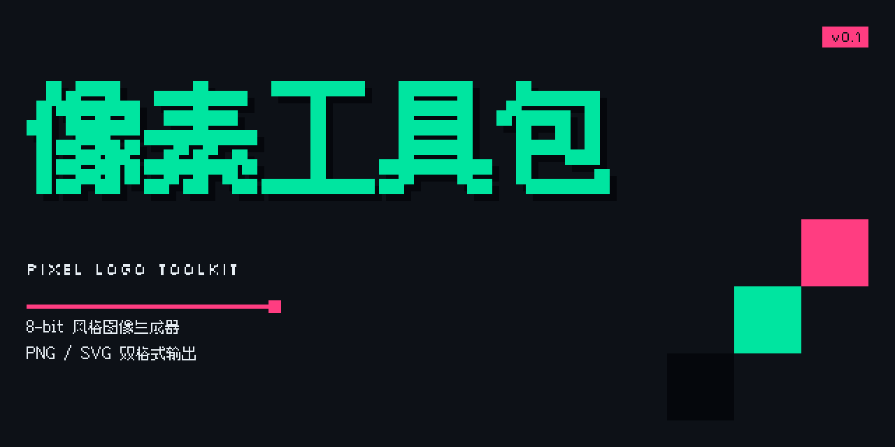
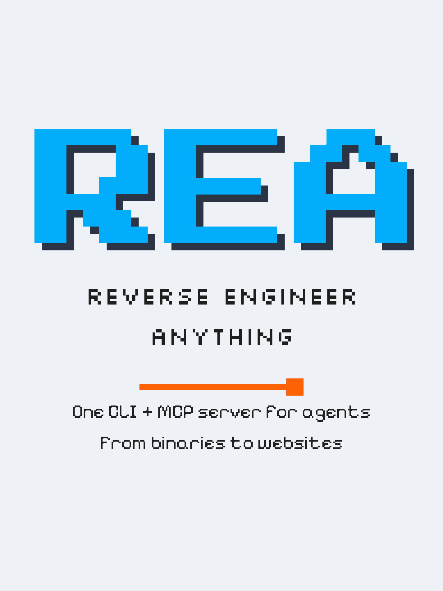
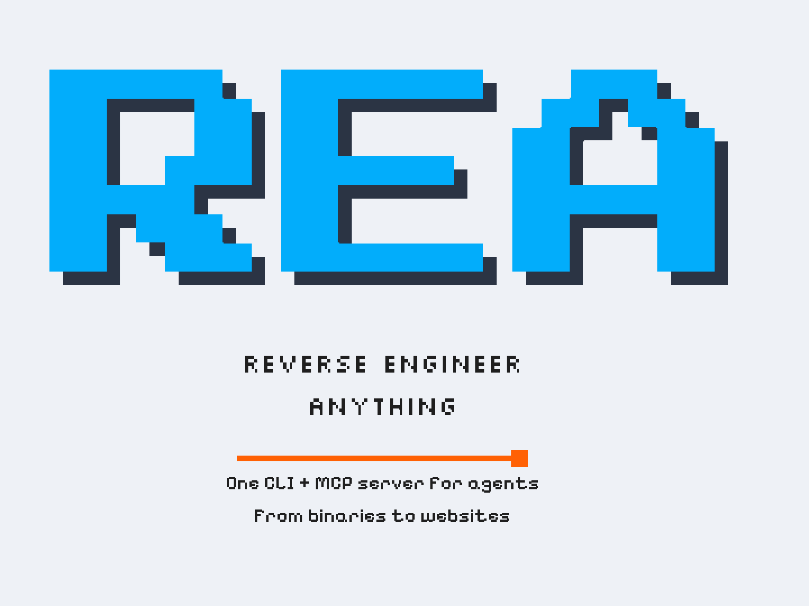

# pixellogo

[](https://github.com/sogeisetsu/pixel-logo-toolkit/actions/workflows/tests.yml)
[](LICENSE)
[](pyproject.toml)

把一句话的标题、副标题、说明文字，渲染成 **8-bit / 复古终端风格**的像素图。
一条命令出图，支持 PNG 与 SVG，内置小红书封面、4:3 横版、GitHub 仓库预览图三种画布。



---

## 特性

- **真像素，不是滤镜**：文字先渲染成二值掩膜，再按行合并成整数坐标矩形，放大后每条边都是方块，没有任何抗锯齿或渐变。
- **中英混排可用**：内置 [Ark Pixel](https://github.com/TakWolf/ark-pixel-font) 12px 比例字体，中文标题不会掉字；中英混排时整行统一字形，不会一行两种笔画粗细。
- **三种画布**：小红书 3:4、横版 4:3、GitHub OG 2:1，各用各的排版策略，不是同一模板硬缩放。
- **两种格式任选**：`-f png` / `-f svg` / `-f both`，SVG 与 PNG 出自同一份几何，像素级一致。
- **配置可复用**：JSONC 配置文件（支持注释与尾逗号）+ 点路径 `--set` 覆盖，一份配置批量出多张。
- **零浏览器依赖**：纯 Python + Pillow 栅格化，CI 与服务器环境都能跑。

---

## 安装

```bash
pipx install git+https://github.com/sogeisetsu/pixel-logo-toolkit.git
```

或从源码安装：

```bash
git clone https://github.com/sogeisetsu/pixel-logo-toolkit.git
cd pixel-logo-toolkit
pip install .
```

要求 Python ≥ 3.9，依赖只有 Pillow。

---

## 快速开始

```bash
pixellogo -t "REA" -s "REVERSE ENGINEER" -d "One CLI for agents"
```

```
out/REA-xhs.png  (1080×1440)
out/REA-xhs.svg  (1080×1440)
```

换成横版并只出 PNG：

```bash
pixellogo -t "REA" -s "REVERSE ENGINEER" -m 4:3 -f png -o cover.png
```

中文标题、换配色、加徽标：

```bash
pixellogo -t "像素工具包" -s "PIXEL LOGO TOOLKIT" \
  --eyebrow "TOOLKIT / 2026" --badge NEW \
  -p cyber -m og -o banner.png
```

---

## 三种画布

| 模式 | 输出尺寸 | 比例 | 用途 |
| --- | --- | --- | --- |
| `xhs` | 1080×1440 | 3:4 | 小红书竖版封面 |
| `4:3` | 1440×1080 | 4:3 | 文章头图、PPT、通用配图 |
| `og` | 1280×640 | 2:1 | GitHub 仓库预览图（Social preview） |

别名：`xiaohongshu` / `red` → `xhs`，`github` / `repo` / `social` → `og`，`4x3` → `4:3`。
需要非常规尺寸时用 `--size 1200x900`。

<table>
  <tr>
    <td align="center"><br><code>xhs</code> 3:4</td>
    <td align="center"><br><code>4:3</code></td>
  </tr>
</table>

三种模式的排版走向不同：

- **`xhs`**：居中排版，标题尽量撑满可用宽度，四周留白充足；
- **`4:3`**：左对齐 + 居中锚定，标题按宽度自适应；
- **`og`**：文本限制在左侧，右下角用三级像素阶梯收口，缩到 400px 宽仍可读。

---

## 输出格式

```bash
pixellogo -t "REA" -f png  -o out/          # 只出 PNG
pixellogo -t "REA" -f svg  -o out/          # 只出 SVG（矢量，可无限缩放）
pixellogo -t "REA" -f both -o out/          # 两种都出（默认）
pixellogo -t "REA" -f both -o cover.png     # 指定文件名，自动产出 cover.png + cover.svg
```

`-o` 传目录时按 `<标题>-<模式>` 命名；传 `.png` / `.svg` 时按扩展名切换格式。
`--scale` 控制输出倍数（逻辑像素 × scale），默认 `2`。

---

## 风格预设

| 预设 | 定位 | 底色 | 主色 | 强调色 |
| --- | --- | --- | --- | --- |
| `terminal` | 复古终端（默认） | `#EEF1F6` | `#02ADFB` | `#FF6104` |
| `cyber` | 暗夜赛博 | `#0D1117` | `#00E5A0` | `#FF3D81` |
| `arcade` | 复古街机 | `#1B1F27` | `#FFD200` | `#FF5F1F` |
| `candy` | 柔和糖果 | `#FFF5F7` | `#FF7EB6` | `#4ECDC4` |
| `minimal` | 极简专业 | `#F8FAFC` | `#2563EB` | `#F97316` |

<table>
  <tr>
    <td></td>
    <td></td>
    <td></td>
  </tr>
  <tr>
    <td align="center"><code>terminal</code></td>
    <td align="center"><code>cyber</code></td>
    <td align="center"><code>arcade</code></td>
  </tr>
  <tr>
    <td></td>
    <td></td>
    <td></td>
  </tr>
  <tr>
    <td align="center"><code>candy</code></td>
    <td align="center"><code>minimal</code></td>
    <td></td>
  </tr>
</table>

单色可用 `--bg` `--fg` `--primary` `--accent` `--shadow-color` 覆盖，只改其中一项也可以。

---

## 命令行参数

**内容**

| 参数 | 说明 |
| --- | --- |
| `-t, --title` | 主标题，`\n` 分行 |
| `-s, --subtitle` | 副标题，可重复传多次，每次一行 |
| `-d, --desc` | 底部说明文字，可重复 |
| `-e, --eyebrow` | 标题上方的小字标签 |
| `--badge` | 右上角徽标文字 |

**风格**

| 参数 | 说明 |
| --- | --- |
| `-p, --preset` | 风格预设，默认 `terminal` |
| `--bg` `--fg` `--primary` `--accent` `--shadow-color` | 单色覆盖 |
| `--shadow-offset` | 投影格数，`0` 关闭，默认 `1` |
| `--title-size` | 标题字号，缺省按画布自动适配（短标题放大、长标题收缩） |
| `--tracking` | 字距倍率，`1.0` 为字体原始步进，越小越紧凑 |
| `--leading` | 行高倍率，默认 `1.0` |
| `--uppercase` | 全部文字转大写 |
| `--font-title` `--font-sub` `--font-body` | 内置字体名或 `.ttf` 路径 |

**排版**

| 参数 | 说明 |
| --- | --- |
| `--align` | `auto` / `left` / `center` |
| `--vertical` | `auto` / `top` / `center` |
| `--margin` | 安全边距比例，默认 `0.06` |
| `--divider` | `line` / `dash` / `block` / `none` |
| `--divider-width` | 分隔线宽度比，默认 `0.42` |
| `--motif` | `auto` / `none` / `blocks`（OG 模式默认阶梯装饰） |

**输出与配置**

| 参数 | 说明 |
| --- | --- |
| `-m, --mode` | 画布模式，默认 `xhs` |
| `--size` | 自定义画布，如 `1200x900` |
| `--scale` | 输出放大倍数，默认 `2` |
| `-f, --format` | `png` / `svg` / `both`，默认 `both` |
| `-o, --out` | 输出目录或文件，默认 `out/` |
| `-c, --config` | JSONC 配置文件 |
| `--set` | 点路径覆盖，如 `colors.accent=#FF3D81`，可重复 |
| `--dry-run` | 只打印合并后的最终配置 |
| `--json` | 机器可读输出 |
| `--open` | 生成后打开第一张图 |
| `--list` | 列出 `presets` / `modes` / `fonts` |

---

## 配置文件（JSONC）

```jsonc
// examples/og.jsonc
{
  "mode": "og",
  "preset": "cyber",

  "title": "像素工具包",
  "subtitle": "PIXEL LOGO TOOLKIT",
  "desc": ["8-bit 风格图像生成器", "PNG / SVG 双格式输出"],

  "badge": "v0.1",
  "layout": {
    "divider": "line",
    "motif": "blocks",
  },
}
```

```bash
pixellogo -c examples/og.jsonc
pixellogo -c examples/og.jsonc --set colors.accent=#FF3D81 -o out/og.png
pixellogo -c examples/og.jsonc -m 4:3 --dry-run
```

**优先级**：内置默认 → `--preset` → 配置文件 → 命令行参数。`--dry-run` 可查看合并结果。
编辑器补全：在配置里写上 `"$schema"` 指向 `src/pixellogo/schema/pixellogo.schema.json` 即可。

顶层写成数组即为批量：

```jsonc
[
  { "mode": "xhs", "title": "REA", "subtitle": ["REVERSE ENGINEER"] },
  { "mode": "og",  "title": "REA", "desc": ["Repository social preview"] }
]
```

```bash
pixellogo -c examples/batch.jsonc -o out/ --json
```

---

## 字体与中文

随包内置四款字体，安装后无需联网：

| 字体 | 用途 | 覆盖 |
| --- | --- | --- |
| Press Start 2P | 主标题 | 拉丁 |
| Silkscreen | 副标题 | 拉丁（无小写字形） |
| Pixelify Sans | 说明文字 | 拉丁（支持大小写） |
| Ark Pixel 12px Proportional | 中文回退 | 中日韩 + 拉丁 |

标题含中文时整行切到 Ark Pixel，并按字号自动加粗一档，避免与拉丁标题的笔画粗细落差过大。
也可以用 `--font-title /path/to/font.ttf` 换成任意像素字体。

---

## 开发

```bash
git clone https://github.com/sogeisetsu/pixel-logo-toolkit.git
cd pixel-logo-toolkit

PYTHONPATH=src python -m pixellogo --version
PYTHONPATH=src python -m unittest discover -s tests -v
```

```
src/pixellogo/
├─ cli.py       命令行入口与参数解析
├─ config.py    四层配置合并与校验
├─ jsonc.py     JSONC 解析（注释 / 尾逗号）
├─ text.py      文字 → 掩膜 → 矩形
├─ layout.py    行栈排版
├─ modes.py     画布规格
├─ presets.py   风格预设
├─ fonts.py     字体注册与字形覆盖检测
├─ scene.py     图元模型
└─ render/      SVG 与 PNG 两个后端
```

风格规格与不变式清单见 [`docs/style-spec.md`](docs/style-spec.md)，设计与实现计划见 [`docs/design.md`](docs/design.md)。

---

## 许可

代码以 [MIT](LICENSE) 发布。
内置字体遵循 SIL Open Font License 1.1，许可原文见 [`src/pixellogo/assets/licenses/`](src/pixellogo/assets/licenses/)。
