# pixellogo

[](https://github.com/sogeisetsu/pixel-logo-toolkit/actions/workflows/tests.yml)
[](LICENSE)
[](pyproject.toml)

把一个标题、几行副标题和说明文字，渲染成 **8-bit / 复古终端风格**的像素图。
一条命令出图，支持 PNG 与 SVG，内置五种画布、十套配色，中英日韩混排不掉字。

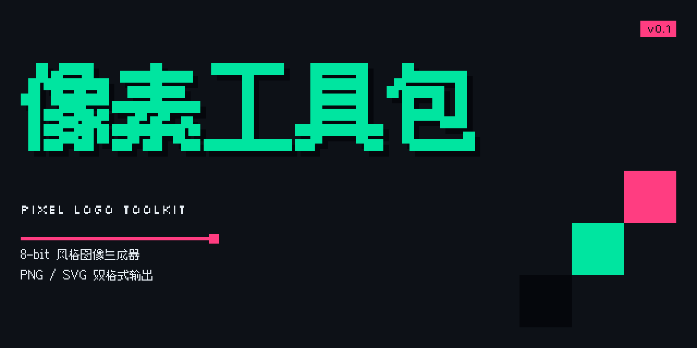

---

## 目录

- [特性](#特性)
- [安装](#安装)
- [快速上手](#快速上手)
- [用法](#用法)
  - [命令结构与参数优先级](#命令结构与参数优先级)
  - [常用配方](#常用配方)
  - [画布模式](#画布模式)
  - [输出格式与路径规则](#输出格式与路径规则)
  - [内容字段](#内容字段)
  - [风格预设与配色](#风格预设与配色)
  - [排版调节](#排版调节)
  - [背景纹理](#背景纹理)
  - [字体与语言](#字体与语言)
  - [配置文件（JSONC）](#配置文件jsonc)
  - [Python API](#python-api)
  - [辅助开关与退出码](#辅助开关与退出码)
- [预设画廊](#预设画廊)
- [开发与测试](#开发与测试)
- [常见问题](#常见问题)
- [许可](#许可)

---

## 特性

- **真像素，不是滤镜**：文字先渲染成二值掩膜，再按行合并成整数坐标矩形。放大后每条边都是方块，全程没有抗锯齿、渐变或羽化。
- **一份几何，两种格式**：PNG 与 SVG 由同一份 `Scene` 输出，像素级一致；SVG 完全自包含，不依赖字体文件。
- **五种画布**：竖版海报、横版卡片、仓库横幅、宽屏幻灯片、方形图片，各用各的排版策略。
- **十套配色**：从复古终端到纸本手账，每套都通过对比度自检。
- **中日韩混排可用**：内置中文像素字体，中英混排时整行统一字形；繁中、日文、韩文按需下载。
- **配置可复用**：JSONC 配置文件（支持注释与尾逗号）+ 点路径覆盖，一份配置批量出多张。
- **零浏览器依赖**：纯 Python + Pillow 栅格化，服务器与 CI 都能跑。

---

## 安装

需要 Python ≥ 3.9，唯一运行时依赖是 Pillow。

```bash
# 推荐：pipx 隔离安装，装完即可用 pixellogo 命令
pipx install git+https://github.com/sogeisetsu/pixel-logo-toolkit.git
```

```bash
# 或者用 pip
pip install git+https://github.com/sogeisetsu/pixel-logo-toolkit.git

# 或者从源码
git clone https://github.com/sogeisetsu/pixel-logo-toolkit.git
cd pixel-logo-toolkit
pip install .
```

> 只把仓库克隆下来**不会**自动得到 `pixellogo` 命令，必须执行上面任意一条安装命令。
> 不想安装时，也可以在仓库目录里用 `PYTHONPATH=src python -m pixellogo ...` 直接运行。

验证安装：

```console
$ pixellogo --version
pixellogo 0.2.0

$ pixellogo --list modes
poster     3:4  竖版海报（小红书封面）                      输出 1080×1440
card       4:3  横版卡片（文章头图 / PPT）                 输出 1440×1080
banner     2:1  仓库横幅（GitHub 预览图）                 输出 1280×640
slide     16:9  宽屏幻灯片（16:9）                      输出 1920×1080
square     1:1  方形图片（社交头像 / 九宫格）                 输出 1080×1080
```

---

## 快速上手

```bash
pixellogo -t "REA" -s "REVERSE ENGINEER" -d "One CLI for agents"
```

```console
$ ls out/
REA-poster.png  REA-poster.svg
```

不带任何参数运行 `pixellogo` 会直接打印帮助；`pixellogo --help`、`pixellogo -h`、`pixellogo help` 等价。

---

## 用法

### 命令结构与参数优先级

```
pixellogo [内容参数] [风格参数] [排版参数] [输出参数] [-c 配置文件] [--set 覆盖]
```

参数分四层生效，后者覆盖前者：

```
内置默认  <  --preset 预设  <  -c 配置文件  <  命令行参数（含 --set）
```

想看四层叠加后的最终结果，加 `--dry-run`：它只打印合并后的完整配置，不渲染、不写盘。

```bash
pixellogo -c examples/og.jsonc -m slide --set colors.accent=#FF3D81 --dry-run
```

### 常用配方

**1. 换画布**

```bash
pixellogo -t "PIXEL" -m slide           # 1920×1080
pixellogo -t "PIXEL" -m square          # 1080×1080
pixellogo -t "PIXEL" --size 1200x900    # 任意尺寸，忽略 -m
```

**2. 换配色风格**

```bash
pixellogo -t "PIXEL" -p cyber           # 暗夜赛博
pixellogo -t "PIXEL" -p paper           # 纸本手账
pixellogo --list presets                # 看全部 10 套
```

**3. 只改一个颜色**

```bash
pixellogo -t "PIXEL" -p forest --accent "#FF3D81"
pixellogo -t "PIXEL" --bg "#0B1020" --fg "#E6EDF3" --primary "#7C3AED"
```

**4. 只出位图 / 只出矢量**

```bash
pixellogo -t "PIXEL" -f png -o out/     # 只要 PNG
pixellogo -t "PIXEL" -f svg -o out/     # 只要 SVG
pixellogo -t "PIXEL" -f both -o out/    # 两种都要（默认）
```

**5. 指定文件名**

```bash
pixellogo -t "PIXEL" -o cover.png                    # 产出 cover.png
pixellogo -t "PIXEL" -f both -o cover.png            # 产出 cover.png + cover.svg
pixellogo -t "PIXEL" -o assets/covers/banner.png     # 目录不存在会自动创建
```

**6. 中文 / 日文标题**

```bash
pixellogo -t "像素工具包" -s "PIXEL LOGO TOOLKIT" --badge NEW
pixellogo -t "ピクセル" --lang ja        # 需先 pixellogo fonts install ja
```

**7. 用配置文件批量出图**

```bash
pixellogo -c examples/batch.jsonc -o out/ -f png
pixellogo -c examples/batch.jsonc -o out/ --json   # 机器可读结果
```

**8. 加背景纹理与装饰**

```bash
pixellogo -t "PIXEL" --bg-pattern grid      # 方格纸
pixellogo -t "PIXEL" --bg-pattern scanlines # 扫描线
pixellogo -t "PIXEL" -m banner --motif none # 关掉横幅右下角的阶梯装饰
```

**9. 生成后直接打开**

```bash
pixellogo -t "PIXEL" --open
```

### 画布模式

模式名是语义化单词，比例只是它的结果。旧的比例写法（`xhs`、`og`、`4:3`、`16:9`、`1:1`…）保留为别名，已有配置不会失效。

| 模式 | 输出尺寸 | 比例 | 用途 | 排版特点 |
| --- | --- | --- | --- | --- |
| `poster` | 1080×1440 | 3:4 | 小红书封面、竖版海报 | 居中排版，标题尽量撑满宽度 |
| `card` | 1440×1080 | 4:3 | 文章头图、PPT 配图 | 左对齐 + 垂直居中 |
| `banner` | 1280×640 | 2:1 | GitHub 仓库预览图 | 文本占左侧，右下水阶梯装饰 |
| `slide` | 1920×1080 | 16:9 | 幻灯片封面 | 左对齐，宽幅留白 |
| `square` | 1080×1080 | 1:1 | 社交方图、九宫格 | 全居中 |

<table>
  <tr>
    <td align="center">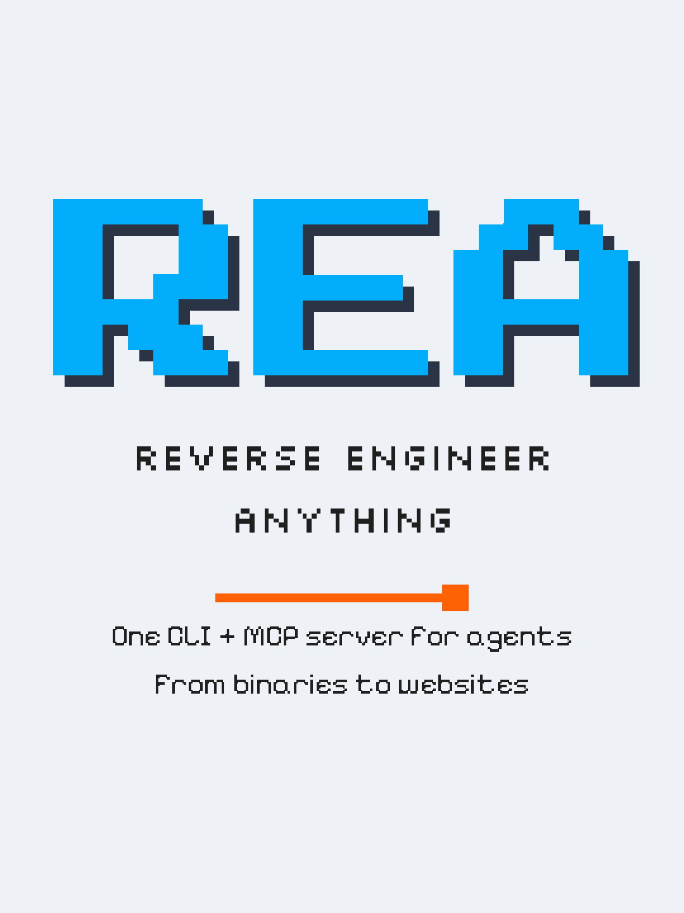<br><code>poster</code></td>
    <td align="center">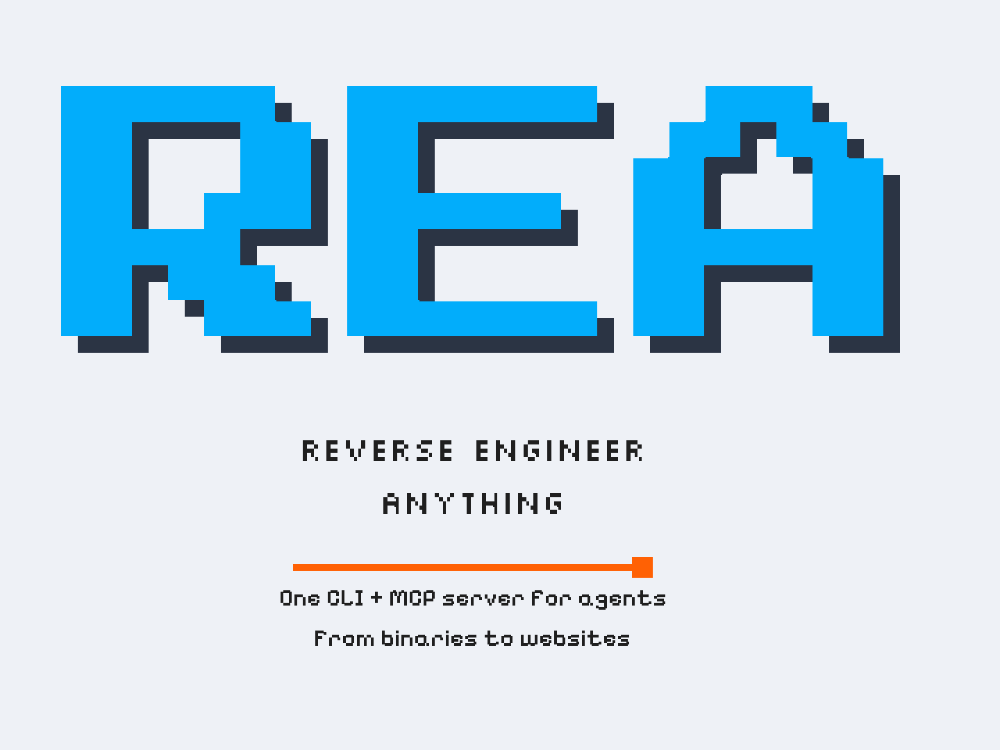<br><code>card</code></td>
  </tr>
  <tr>
    <td align="center">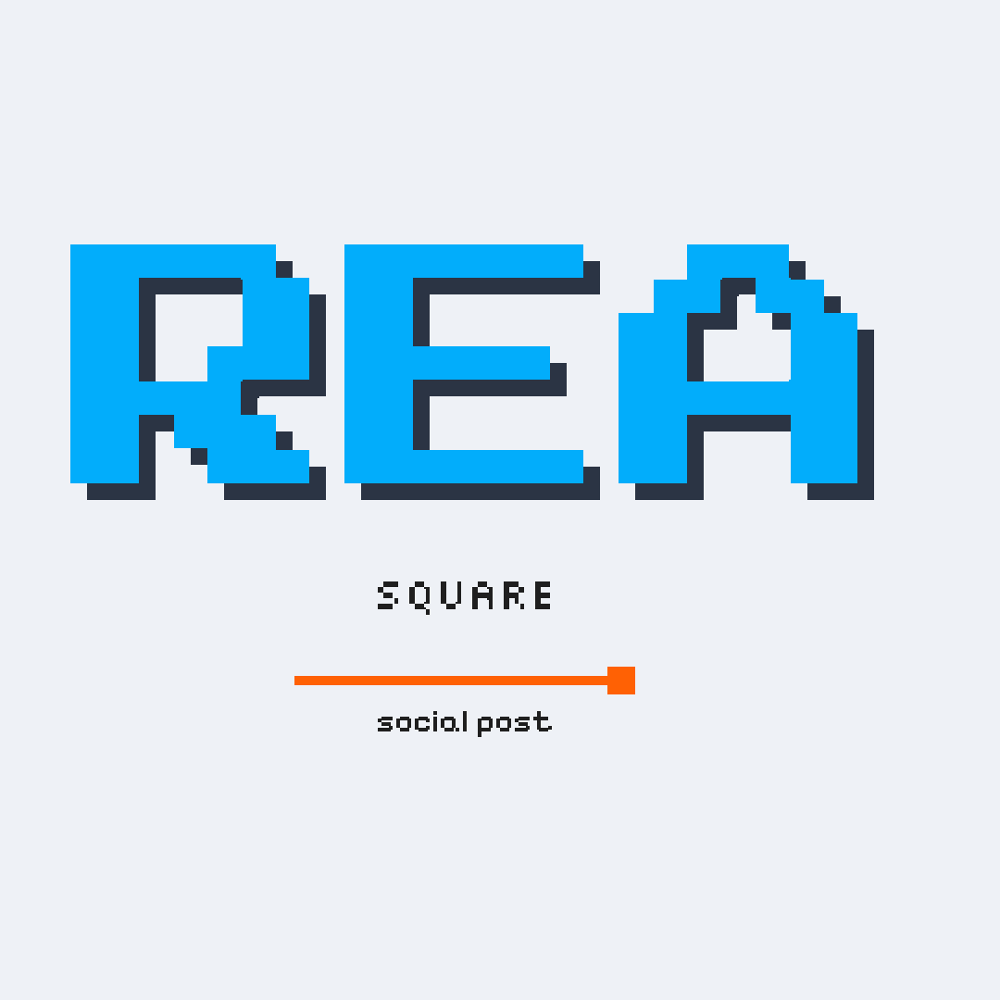<br><code>square</code></td>
    <td align="center">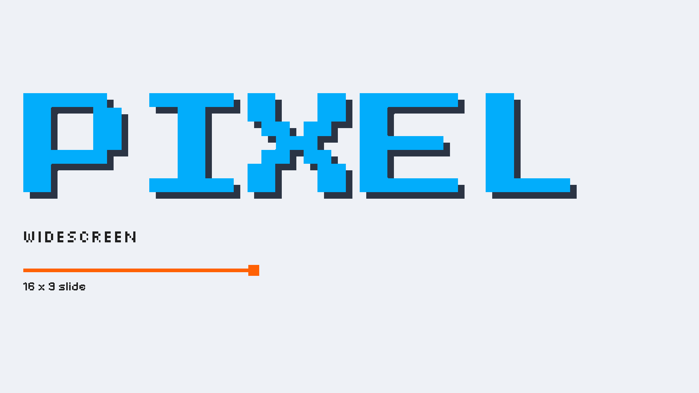<br><code>slide</code></td>
  </tr>
</table>

常用别名：`xhs` / `xiaohongshu` / `red` / `3:4` → `poster`；`og` / `github` / `repo` / `social` / `2:1` → `banner`；`4:3` / `landscape` → `card`；`16:9` / `wide` → `slide`；`1:1` / `avatar` → `square`。

任何模式都可以用 `--size 宽x高` 覆盖；输出尺寸 = 逻辑尺寸 × `--scale`（默认 2）。

### 输出格式与路径规则

| `-o` 传什么 | `-f` | 结果 |
| --- | --- | --- |
| 目录（`out/`） | `png` | `out/<标题>-<模式>.png` |
| 目录（`out/`） | `svg` | `out/<标题>-<模式>.svg` |
| 目录（`out/`） | `both` | 上面两个都产出 |
| 文件（`cover.png`） | `png` | `cover.png` |
| 文件（`cover.png`） | `both` | `cover.png` + `cover.svg` |
| 文件（`cover.png`） | `svg` | `cover.svg`（格式由 `-f` 决定，主文件名沿用） |

- 标题里的空格与非法字符会转成 `-`，中文字符保留。
- 批量出图时同名文件自动加序号（`REA-poster-2.png`），不会互相覆盖。
- `--scale` 是整数放大倍数，默认 2；`--scale 1` 得到与逻辑尺寸相同的输出。

### 内容字段

| 参数 | 说明 | 多行写法 |
| --- | --- | --- |
| `-t, --title` | 主标题，**必填** | 用 `\n` 分隔，或配置里写 `\n` |
| `-s, --subtitle` | 副标题 | 重复传参，每次一行：`-s "A" -s "B"` |
| `-d, --desc` | 底部说明文字 | 同上，`-d "A" -d "B"` |
| `-e, --eyebrow` | 标题上方的小字标签 | 单行 |
| `--badge` | 右上角方块徽标文字 | 单行 |

```bash
pixellogo \
  -e "TOOLKIT / 2026" \
  -t "像素工具包" \
  -s "PIXEL LOGO TOOLKIT" -s "FOR AGENTS" \
  --badge NEW \
  -d "8-bit 风格图像生成器" -d "PNG / SVG 双格式输出"
```

### 风格预设与配色

| 预设 | 定位 | 底色 | 主色 | 强调色 |
| --- | --- | --- | --- | --- |
| `terminal` | 复古终端（默认） | `#EEF1F6` | `#02ADFB` | `#FF6104` |
| `cyber` | 暗夜赛博 | `#0D1117` | `#00E5A0` | `#FF3D81` |
| `arcade` | 复古街机 | `#1B1F27` | `#FFD200` | `#FF5F1F` |
| `candy` | 柔和糖果 | `#FFF5F7` | `#FF7EB6` | `#4ECDC4` |
| `minimal` | 极简专业 | `#F8FAFC` | `#2563EB` | `#F97316` |
| `noir` | 黑白纪实 | `#F4F4F5` | `#18181B` | `#E11D48` |
| `forest` | 森林苔绿 | `#F0F4EF` | `#2F6B3C` | `#D97706` |
| `sunset` | 黄昏日落 | `#2B1B2F` | `#FF8A3D` | `#FFD166` |
| `ocean` | 深海青蓝 | `#E8F1F5` | `#0077B6` | `#2A9D8F` |
| `paper` | 纸本手账 | `#F5EEE1` | `#8C3B2E` | `#C9822E` |

`pixellogo --list presets` 会额外显示每套预设字色与底色的对比度。

单色覆盖（优先级高于预设，可只改其中一项）：

```bash
--bg <HEX>  --fg <HEX>  --primary <HEX>  --accent <HEX>  --shadow-color <HEX>
```

一个预设由六要素组成：底色、字色、主色（标题）、强调色（分隔线/徽标）、投影色，以及字体组合与投影强度。

### 排版调节

| 参数 | 取值 | 默认 | 作用 |
| --- | --- | --- | --- |
| `--align` | `auto` / `left` / `center` | `auto` | 水平对齐；`auto` 跟随画布模式 |
| `--vertical` | `auto` / `top` / `center` | `auto` | 内容块纵向锚定 |
| `--margin` | 0–0.4 | `0.06` | 安全边距，相对画布短边 |
| `--divider` | `line` / `dash` / `block` / `none` | 跟随预设 | 标题与说明之间的分隔线样式 |
| `--divider-width` | 0.05–1.0 | `0.42` | 分隔线宽度占文本区比例 |
| `--motif` | `auto` / `none` / `blocks` | `auto` | 右下角像素阶梯装饰（`banner` 默认开） |
| `--title-size` | 像素 | 自动 | 显式指定标题字号，不做放大 |
| `--tracking` | 0.5–1.5 | `1.0` | 字距倍率，`0.9` 更紧凑 |
| `--leading` | 0.8–2.0 | `1.0` | 行高倍率 |
| `--uppercase` | 开关 | 关 | 全部文字转大写 |
| `--shadow-offset` | 0–4 | `1` | 标题投影格数，`0` 关闭 |

标题字号默认**双向自适应**：长标题自动收缩到文本区宽度以内，短标题自动放大到接近撑满，上限约画布高度的 42%。

```bash
pixellogo -t "PIXEL" --tracking 0.88 --leading 1.2 --uppercase
pixellogo -t "PIXEL" --align left --vertical top --divider dash
pixellogo -t "PIXEL" --shadow-offset 0            # 纯扁平，无投影
```

### 背景纹理

| 取值 | 效果 | 说明 |
| --- | --- | --- |
| `none` | 纯色底 | 默认，符合「无纹理」风格不变式 |
| `grid` | 方格纸 | 每格约画布短边的 1/20，1px 线条 |
| `dots` | 点阵 | 网格交点上的小方块 |
| `scanlines` | 扫描线 | 等距横向细线，CRT 观感 |

纹理色由底色与字色按 10% 混合而成，仍是**纯色**，不引入透明度或渐变。

```bash
pixellogo -t "GRID" -p forest --bg-pattern grid
pixellogo -t "DOTS" -p paper --bg-pattern dots
pixellogo -t "SCANLINES" -p cyber --bg-pattern scanlines
```

<table>
  <tr>
    <td align="center">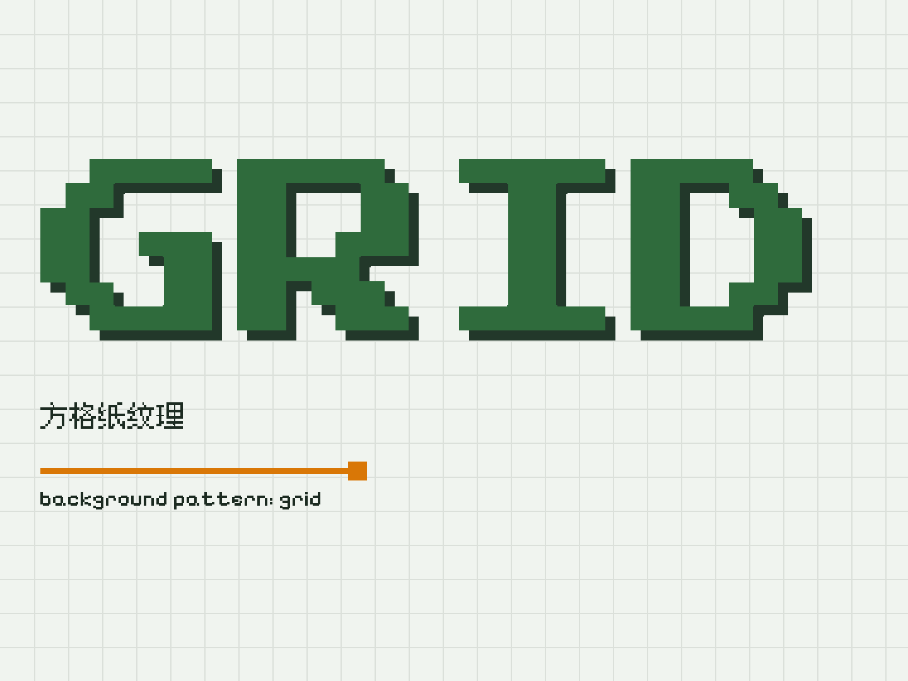<br><code>--bg-pattern grid</code></td>
    <td align="center">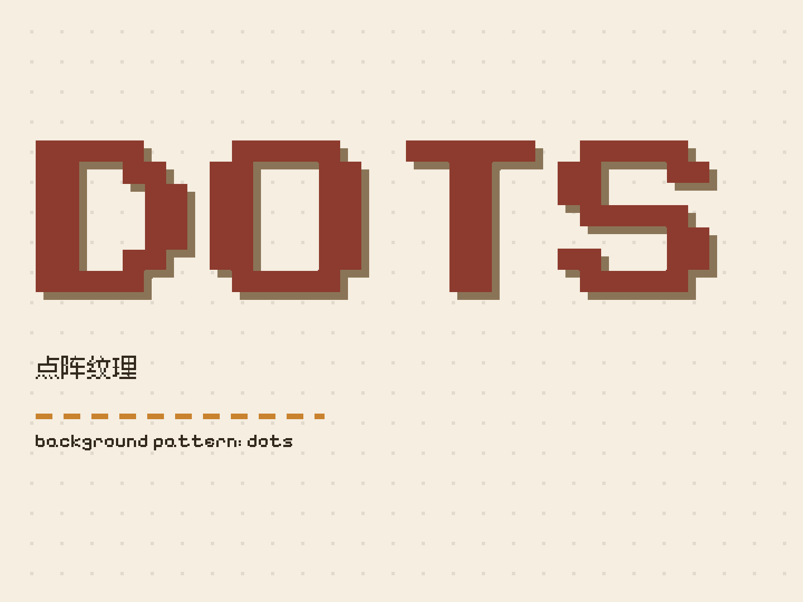<br><code>--bg-pattern dots</code></td>
    <td align="center">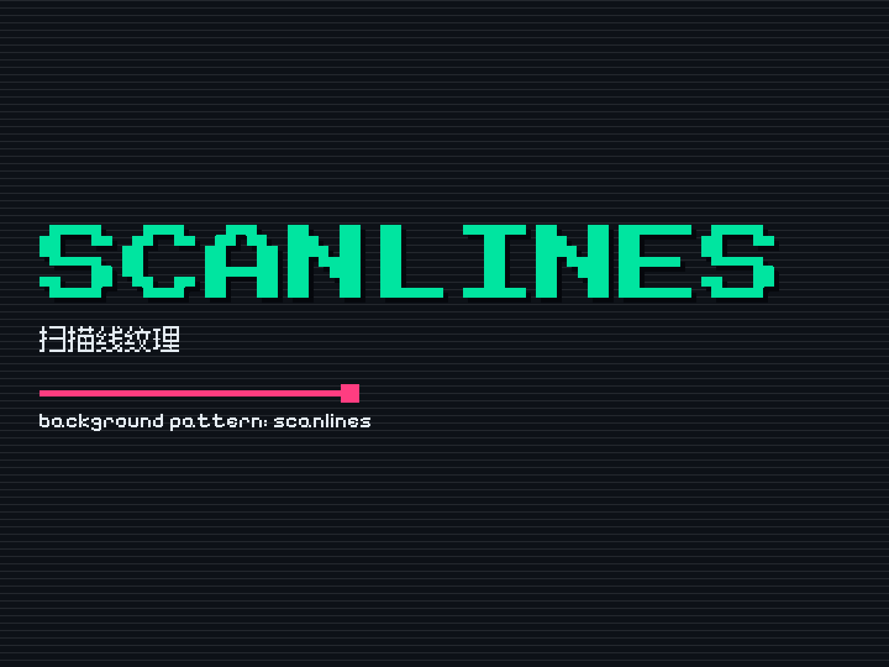<br><code>--bg-pattern scanlines</code></td>
  </tr>
</table>

上例分别用了 `forest`、`paper`、`cyber` 三套预设，可以看到纹理色会自动跟随配色（它由底色与字色混合而来，不是写死的灰）。

### 字体与语言

随包内置四款字体，安装后无需联网：

| 字体 | 用途 | 覆盖 |
| --- | --- | --- |
| Press Start 2P | 主标题 | 拉丁 |
| Silkscreen | 副标题 | 拉丁（无小写字形） |
| Pixelify Sans | 说明文字 | 拉丁（支持大小写） |
| Ark Pixel 12px Proportional | 简中 / 繁中 / 日文回退 | 汉字 + 假名 + 拉丁 |
| Galmuri 11px | 韩文回退（按需下载） | 谚文 + 汉字 + 假名 + 拉丁 |

**中英混排**时整行会切到中文像素字体（避免一行两种笔画粗细），并按字号自动加粗一档。

**字形变体**：简体随包内置，繁中 / 日文 / 韩文按需下载到 `~/.pixellogo/fonts`。

```console
$ pixellogo fonts
zh-hans  随包内置     Ark Pixel 12px (zh-hans)
zh-hant  已下载      Ark Pixel 12px (zh-hant)
ja       已下载      Ark Pixel 12px (ja)
ko       已下载      Galmuri 11px (ko)

$ pixellogo fonts install ja
下载 ja 字体包…
  https://github.com/TakWolf/ark-pixel-font/releases/download/2026.10.25/…
  100%  35MB / 35MB
已安装：C:\Users\you\.pixellogo\fonts\ArkPixel-ja.ttf

$ pixellogo -t "ピクセル" --lang ja
```

<table>
  <tr>
    <td align="center">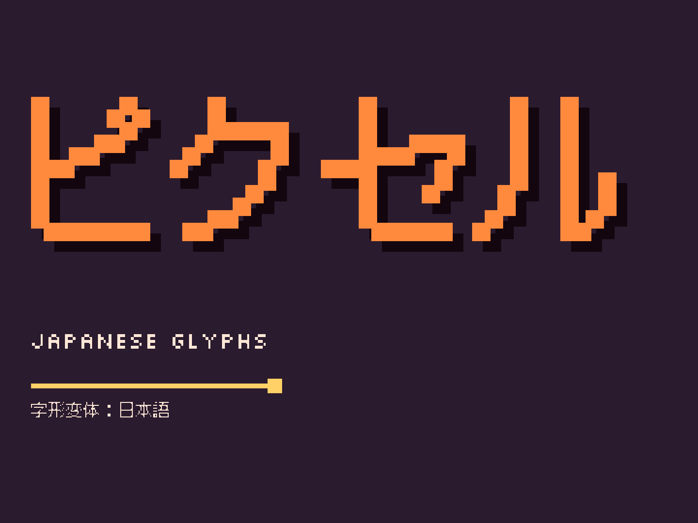<br><code>--lang ja</code> 日文字形：片假名与汉字按日文标准字形渲染，标题自动加粗一档</td>
  </tr>
</table>

- `--lang` 可选 `zh-hans` / `zh-hant` / `ja` / `ko`，也接受 `zh-cn`、`zh-tw`、`jp`、`kr` 等写法。
- 韩语走的是 [Galmuri](https://github.com/quiple/galmuri) 而不是 Ark Pixel——后者的 `ko` 版并不含谚文，
  用它渲染韩文会得到一排豆腐块。
- 内容里没有中日韩字符时，缺少对应字体不会报错。
- 环境变量：`PIXELLOGO_FONT_DIR` 改字体目录，`PIXELLOGO_FONT_MIRROR` 指定下载镜像。
- 换用任意像素字体：`--font-title /path/to/font.ttf`（同理 `--font-sub`、`--font-body`）。

### 配置文件（JSONC）

```jsonc
// examples/og.jsonc
{
  "mode": "banner",
  "preset": "cyber",

  "title": "像素工具包",
  "subtitle": "PIXEL LOGO TOOLKIT",     // 字符串或数组都行
  "desc": ["8-bit 风格图像生成器", "PNG / SVG 双格式输出"],

  "badge": "v0.1",
  "layout": {
    "divider": "line",
    "motif": "blocks",
  },
}
```

```bash
pixellogo -c examples/og.jsonc
pixellogo -c examples/og.jsonc -m card                    # 命令行覆盖 mode
pixellogo -c examples/og.jsonc --set colors.accent=#FF3D81
```

全部可用键（与 `--dry-run` 输出的结构一致）：

| 键 | 类型 | 说明 |
| --- | --- | --- |
| `mode` | 字符串 | 画布模式，默认 `poster` |
| `size` | `"1200x900"` | 自定义画布，优先于 `mode` |
| `preset` | 字符串 | 风格预设，默认 `terminal` |
| `title` | 字符串 | 主标题，必填 |
| `subtitle` / `desc` | 字符串或数组 | 每项一行 |
| `eyebrow` / `badge` | 字符串 | 小字标签 / 右上角徽标 |
| `lang` | 字符串 | 字形变体，默认 `zh-hans` |
| `colors` | 对象 | `bg` `fg` `primary` `accent` `shadow` |
| `fonts` | 对象 | `title` `sub` `body`（字体名或 .ttf 路径） |
| `layout` | 对象 | `align` `vertical` `margin` `divider` `dividerWidth` `titleSize` `shadowOffset` `motif` `pattern` `tracking` `leading` `uppercase` `cjkBold` |
| `output` | 对象 | `dir` / `path` / `scale` / `formats` |
| `scale` / `out` / `format` | 顶层简写 | 等价于 `output` 里的对应项 |

顶层写成数组即为批量，一次出多张：

```jsonc
[
  { "mode": "poster", "title": "REA", "subtitle": ["REVERSE ENGINEER"] },
  { "mode": "banner", "title": "REA", "desc": ["Repository social preview"] }
]
```

```bash
pixellogo -c examples/batch.jsonc -o out/ -f png --json
```

编辑器补全：在配置里加 `"$schema"` 指向 `src/pixellogo/schema/pixellogo.schema.json`（或已安装包内的同名文件）。

### Python API

```python
from pixellogo import render, render_many, make_image, make_scene, to_svg_text

# 写盘，返回生成的文件路径
paths = render(title="REA", mode="banner", preset="cyber", format="png", out="out/")

# 只要 Pillow 位图（不落盘）
image = make_image(title="REA", mode="square", scale=1)
image.save("preview.png")

# 只要几何（可自行检查色板、边界）
scene = make_scene(title="REA", mode="poster")
print(scene.width, scene.height, len(scene.rects), scene.colors)

# 只要 SVG 源码
svg = to_svg_text(title="REA", mode="slide")

# 批量
render_many(
    [{"title": "A", "mode": "poster"}, {"title": "B", "mode": "square"}],
    out="out",
    format="png",
)
```

参数键与 JSONC 配置完全一致，配置里能写的 API 都能写，例如：

```python
render(
    title="像素工具包",
    subtitle=["PIXEL LOGO TOOLKIT"],
    colors={"primary": "#8C3B2E", "accent": "#C9822E"},
    layout={"align": "left", "divider": "dash", "pattern": "grid"},
    out="out/",
)
```

### 辅助开关与退出码

| 参数 | 作用 |
| --- | --- |
| `-h, --help` | 打印帮助（裸执行 `pixellogo` 或 `pixellogo help` 同理） |
| `-V, --version` | 打印版本 |
| `--list modes` / `presets` / `fonts` | 列出可选项 |
| `--dry-run` | 打印合并后的配置，不渲染 |
| `--json` | 以 JSON 输出结果，便于脚本消费 |
| `--open` | 生成后用系统默认程序打开第一张图 |
| `-c, --config` | 指定 JSONC 配置文件 |
| `--set KEY=VALUE` | 点路径覆盖，可重复 |

退出码：`0` 成功，`2` 参数或配置有误（错误信息写到 stderr）。

---

## 预设画廊

<table>
  <tr>
    <td align="center">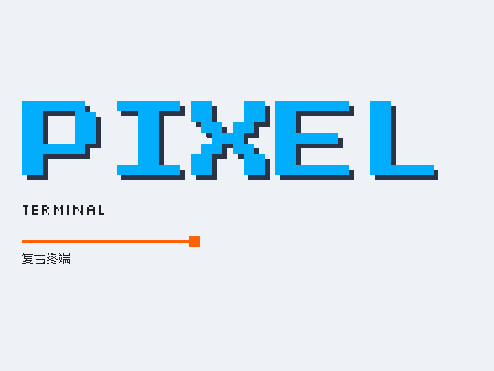<br><code>terminal</code></td>
    <td align="center">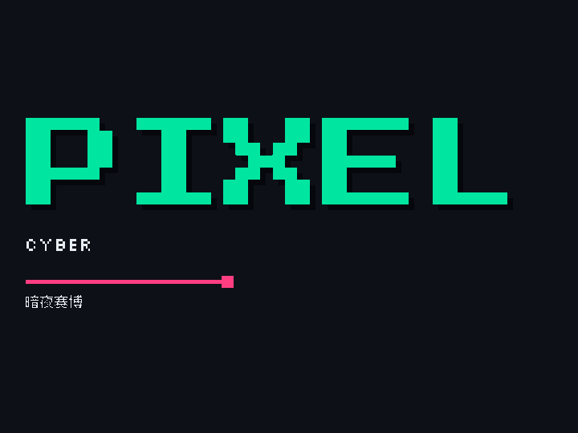<br><code>cyber</code></td>
    <td align="center">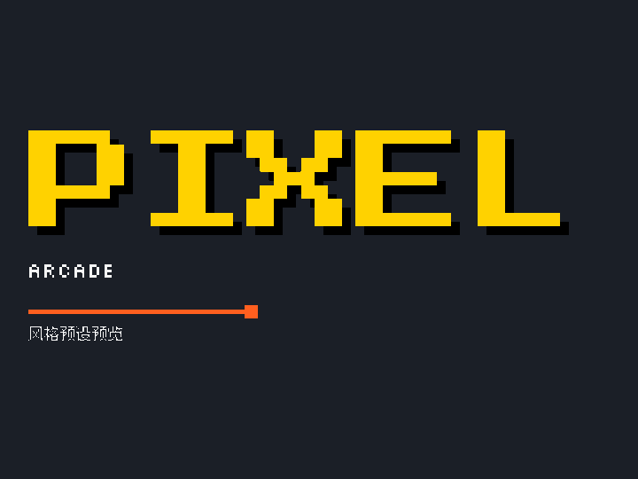<br><code>arcade</code></td>
  </tr>
  <tr>
    <td align="center">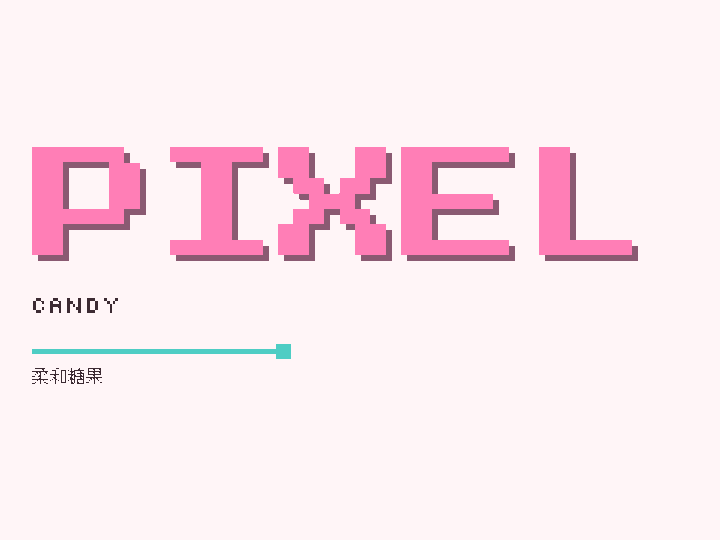<br><code>candy</code></td>
    <td align="center">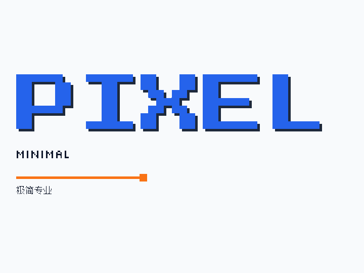<br><code>minimal</code></td>
    <td align="center">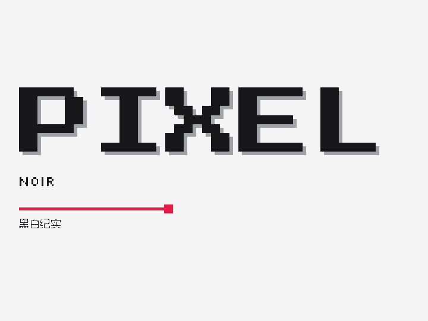<br><code>noir</code></td>
  </tr>
  <tr>
    <td align="center">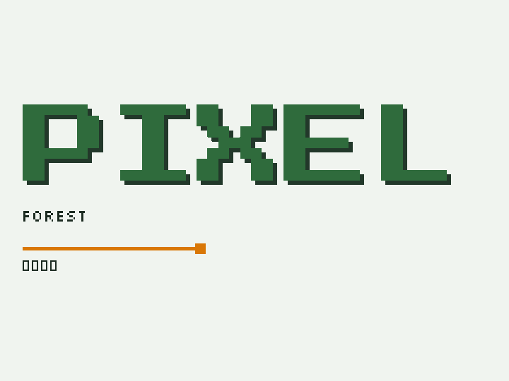<br><code>forest</code></td>
    <td align="center">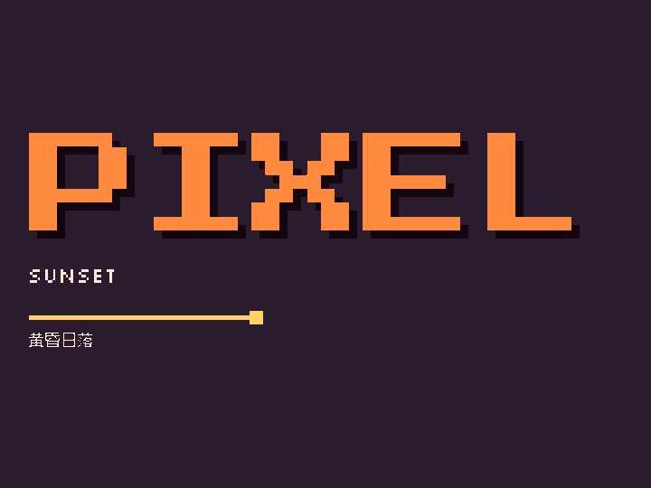<br><code>sunset</code></td>
    <td align="center">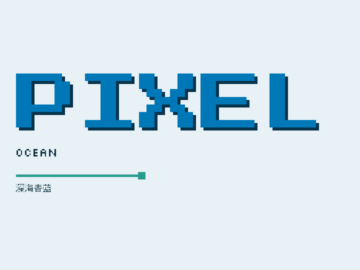<br><code>ocean</code></td>
  </tr>
  <tr>
    <td align="center">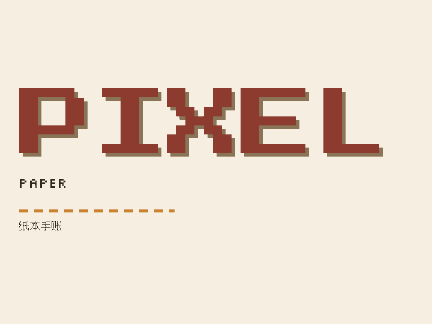<br><code>paper</code></td>
    <td></td>
    <td></td>
  </tr>
</table>

---

## 开发与测试

```bash
git clone https://github.com/sogeisetsu/pixel-logo-toolkit.git
cd pixel-logo-toolkit

PYTHONPATH=src python -m pixellogo --version
PYTHONPATH=src python -m unittest discover -s tests -v
```

```
src/pixellogo/
├─ cli.py       命令行入口与参数解析
├─ api.py       Python API
├─ config.py    四层配置合并与校验
├─ jsonc.py     JSONC 解析（注释 / 尾逗号）
├─ text.py      文字 → 掩膜 → 矩形
├─ layout.py    行栈排版、投影、装饰与背景纹理
├─ modes.py     画布规格
├─ presets.py   风格预设与对比度计算
├─ fonts.py     字体注册、字形覆盖检测、语言变体
├─ fontpack.py  多语言字体包按需下载
├─ paths.py     输出命名规则
├─ scene.py     图元模型
└─ render/      SVG 与 PNG 两个后端
```

风格规格与不变式清单见 [`docs/style-spec.md`](docs/style-spec.md)，设计与实现记录见 [`docs/design.md`](docs/design.md)。

---

## 常见问题

**标题被缩得太小？**
标题宽度受模式与文本区比例限制。换更宽的画布（`-m slide`）、调小 `--margin`，或用 `--title-size` 直接指定字号。

**提示 `pixellogo: command not found`？**
说明还没安装，只克隆了源码。在仓库目录执行 `pip install .`（或 `pip install -e .` 开发模式、`pipx install .`）后重开终端。
仍找不到的话，检查 Python 的脚本目录是否在 `PATH` 里：Windows 是 `<Python 安装目录>\Scripts`，macOS / Linux 通常是 `~/.local/bin`。
临时不安装：`PYTHONPATH=src python -m pixellogo -t "REA"`。

**中文出现方块或缺字？**
默认内置简体字体；若标题是繁体、日文或韩文，先 `pixellogo fonts install <lang>` 并加 `--lang`。

**PNG 边缘会有灰边吗？**
不会。渲染全程按整数矩形填充，不经过任何插值缩放。

**能改背景为图片吗？**
不能，风格不变式要求纯色底。可以用 `--bg-pattern` 换成方格、点阵或扫描线。

**怎么设置 GitHub 仓库预览图？**
生成 `banner` 模式的图（1280×640），到仓库 Settings → Social preview 手动上传。

---

## 许可

代码以 [MIT](LICENSE) 发布。
内置字体遵循 SIL Open Font License 1.1，许可原文见 [`src/pixellogo/assets/licenses/`](src/pixellogo/assets/licenses/)。
