# 命令示例画廊

> 本文档目前只有中文版；功能总览与安装说明见英文 [README.md](../README.md)。

58 张成品，全部由 `pixellogo` 一条命令生成，覆盖五种画布、十套预设、四种背景纹理。
前半部分是不同语言与工具的标识卡；后半部分是日语 / 韩语 / 繁体中文的在地文化示例，文案取自当地辨识度高的作品、人物与地点。
每张图下方标注**生成它的完整命令**，可直接复制运行。

**这份 Markdown 同时是[画廊页面](index.html)的数据源。** 页面不需要手工编辑：

```bash
python tools/gallery_site.py     # 解析本文件 → docs/gallery-data.js
```

新增一张图 = 复制一个小节，改标题、图片、命令三处，再跑一次脚本。
分组由 `##` 标题决定（对应页面上的筛选按钮），每组的英文名写在标题下方的 `>` 引用行里。

> 想在浏览器里翻着看：<https://sogeisetsu.github.io/pixel-logo-toolkit/> —— 58 张图按分类筛选、懒加载、点击放大、可复制命令。
> 本地直接打开 `docs/index.html` 也可以（先跑一次上面的脚本）。

> 图片均以 `-f png` 输出到 `docs/images/gallery/`；想换格式把 `-f png` 改成 `svg` 或 `both` 即可。
> 多语言小节需要先下载对应字形字体，命令见各小节开头。

## 索引

| # | 主题 | 画布 | 预设 | 纹理 | 语言 |
| --- | --- | --- | --- | --- | --- |
| 01 | PYTHON | `poster` | `terminal` | `none` | — |
| 02 | KOTLIN | `poster` | `candy` | `none` | — |
| 03 | DOCKER | `poster` | `forest` | `grid` | — |
| 04 | GRAPHQL | `poster` | `ocean` | `none` | — |
| 05 | ANSIBLE | `poster` | `noir` | `dots` | — |
| 06 | PHP | `poster` | `arcade` | `none` | — |
| 07 | RUST | `card` | `arcade` | `none` | — |
| 08 | ZIG | `card` | `forest` | `none` | — |
| 09 | ELIXIR | `card` | `ocean` | `none` | — |
| 10 | SQL | `card` | `minimal` | `dots` | — |
| 11 | VIM | `card` | `terminal` | `none` | — |
| 12 | KUBECTL | `card` | `ocean` | `dots` | — |
| 13 | KAFKA | `card` | `sunset` | `grid` | — |
| 14 | NIX | `card` | `paper` | `scanlines` | — |
| 15 | WASM | `card` | `cyber` | `none` | — |
| 16 | COBOL | `card` | `terminal` | `none` | — |
| 17 | GO | `banner` | `cyber` | `none` | — |
| 18 | SWIFT | `banner` | `sunset` | `none` | — |
| 19 | BASH | `banner` | `cyber` | `scanlines` | — |
| 20 | NGINX | `banner` | `noir` | `none` | — |
| 21 | LINUX | `banner` | `paper` | `none` | — |
| 22 | TERRAFORM | `banner` | `forest` | `grid` | — |
| 23 | TYPESCRIPT | `slide` | `minimal` | `none` | — |
| 24 | HASKELL | `slide` | `paper` | `none` | — |
| 25 | POSTGRESQL | `slide` | `ocean` | `grid` | — |
| 26 | GRPC | `slide` | `forest` | `none` | — |
| 27 | C++ | `square` | `noir` | `none` | — |
| 28 | LUA | `square` | `terminal` | `grid` | — |
| 29 | REDIS | `square` | `arcade` | `scanlines` | — |
| 30 | GIT | `square` | `minimal` | `none` | — |
| 31 | RUBY | `square` | `candy` | `none` | — |
| 32 | ELISP | `square` | `sunset` | `dots` | — |
| 33 | 人間失格 | `poster` | `paper` | `none` | `ja` |
| 34 | 坂本龍馬 | `banner` | `terminal` | `none` | `ja` |
| 35 | 東京 | `square` | `ocean` | `dots` | `ja` |
| 36 | 안중근 | `poster` | `noir` | `none` | `ko` |
| 37 | 한글 | `card` | `paper` | `none` | `ko` |
| 38 | 서울 | `square` | `sunset` | `grid` | `ko` |
| 39 | 蘭亭 | `poster` | `paper` | `none` | `zh-hant` |
| 40 | 香港 | `banner` | `ocean` | `scanlines` | `zh-hant` |

> 上表为 01–40 的基础示例；**41–52** 是小红书风格封面、**53–58** 是文字密集型示例，两者都在下文单独成节。

覆盖情况：**5/5** 画布 · **10/10** 预设 · **4/4** 纹理（`dots`、`grid`、`none`、`scanlines`） · **3** 种语言字形（`ja`、`ko`、`zh-hant`）。

## 小红书风格封面（`poster`，1080×1440 · 3:4）

> Xiaohongshu

12 张一组，按小红书的内容分类组织：**生活方式**、**好物分享**、**穿搭**、**美食**、**旅行打卡**。
共同点是小红书封面的三个特征：3:4 竖版、单张只有一个 2–3 字的主视觉大字、下方留白处放一句附和文案与话题标签。
配色全部取自生活场景（糖果粉、纸本米、奶油陶土、日落橙、海蓝、森林绿），刻意避开 `arcade` / `cyber` 这类偏技术的深色霓虹。

```bash
# 整批生成（配置里已写好每张的 out，文件名固定）
pixellogo -c examples/xhs-gallery.jsonc -f png

# 想同时要矢量版
pixellogo -c examples/xhs-gallery.jsonc -f both
```

| # | 主题 | 分类 | 预设 | 纹理 | 话题 |
| --- | --- | --- | --- | --- | --- |
| 01 | 慢生活 | 生活方式 | `candy` | `dots` | #生活方式 #松弛感 |
| 02 | 早起 | 生活方式 | `paper` | `grid` | #生活方式 #晨间 |
| 03 | 断舍离 | 生活方式 | `minimal` | `none` | #生活方式 #整理收纳 |
| 04 | 好物 | 好物分享 | `sunset` | `dots` | #好物分享 #平价好物 |
| 05 | 桌面 | 好物分享 | `ocean` | `grid` | #好物分享 #桌面改造 |
| 06 | 平价 | 好物分享 | `paper` + 暖陶覆盖 | `dots` | #好物分享 #居家好物 |
| 07 | 通勤 | 穿搭 | `noir` | `none` | #穿搭 #通勤穿搭 |
| 08 | 秋日 | 穿搭 | `forest` | `scanlines` | #穿搭 #秋日穿搭 |
| 09 | 早饭 | 美食 | `candy` | `dots` | #美食 #早饭打卡 |
| 10 | 咖啡 | 美食 | `paper` | `grid` | #美食 #咖啡日常 |
| 11 | 出发 | 旅行打卡 | `ocean` | `scanlines` | #旅行打卡 #周边游 |
| 12 | 海边 | 旅行打卡 | `sunset` | `none` | #旅行打卡 #海边日落 |

> 全部 12 张均可点击放大查看：[gallery.html](gallery.html)（支持按分类筛选、键盘 ← → 翻页、下载原图）。

### 慢生活 · 糖果粉 + 点阵，三个字撑满竖版

> Candy pink over a dot matrix; three characters fill the portrait.

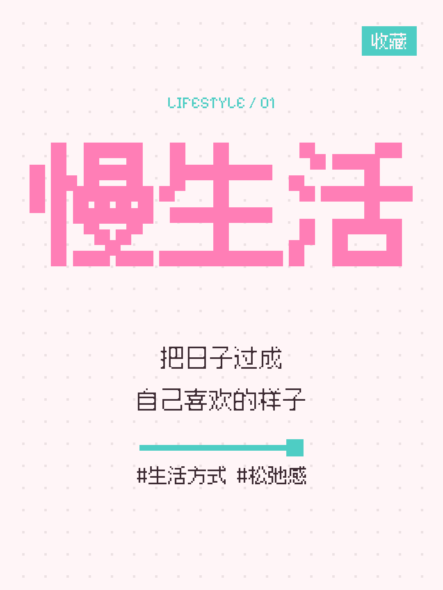

```bash
pixellogo -e "LIFESTYLE / 01" -t 慢生活 -s 把日子过成 -s 自己喜欢的样子 -d "#生活方式 #松弛感" \
--badge 收藏 -m poster -p candy --bg-pattern dots --shadow-offset 0 -f png \
-o docs/images/gallery/xhs-01-slow-life.png
```

画布 `poster` · 预设 `candy` · 纹理 `dots` · 分类 生活方式

### 早起 · 纸本方格像手账本，时间做徽标

> Paper grid like a journal spread, with the hour as the badge.

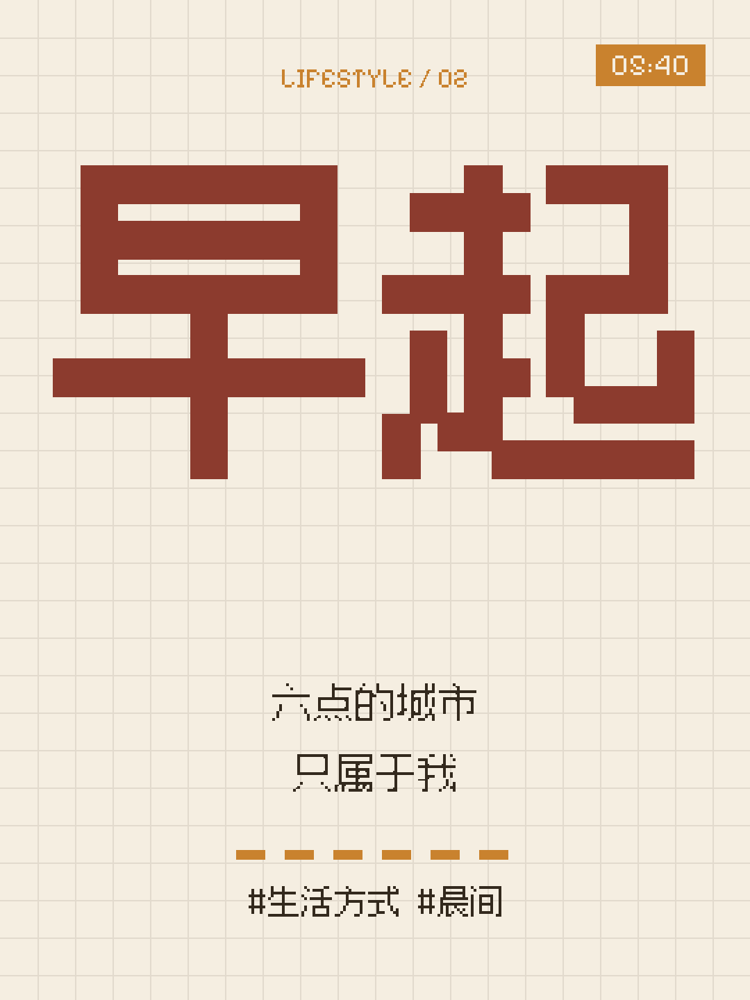

```bash
pixellogo -e "LIFESTYLE / 02" -t 早起 -s 六点的城市 -s 只属于我 -d "#生活方式 #晨间" \
--badge "05:40" -m poster -p paper --bg-pattern grid --divider dash --shadow-offset 0 -f png \
-o docs/images/gallery/xhs-02-early-rising.png
```

画布 `poster` · 预设 `paper` · 纹理 `grid` · 分类 生活方式

### 断舍离 · 极简白底 + 块状分隔线

> Minimal white ground with a block divider.

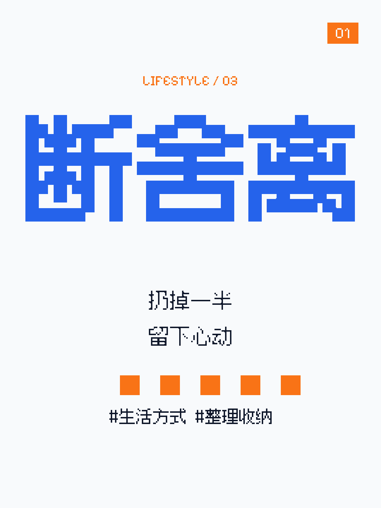

```bash
pixellogo -e "LIFESTYLE / 03" -t 断舍离 -s 扔掉一半 -s 留下心动 -d "#生活方式 #整理收纳" \
--badge 01 -m poster -p minimal --divider block --shadow-offset 0 -f png \
-o docs/images/gallery/xhs-03-declutter.png
```

画布 `poster` · 预设 `minimal` · 分类 生活方式

### 好物 · 深色底是这一组里唯一的高对比封面

> The only dark, high-contrast cover in this set.

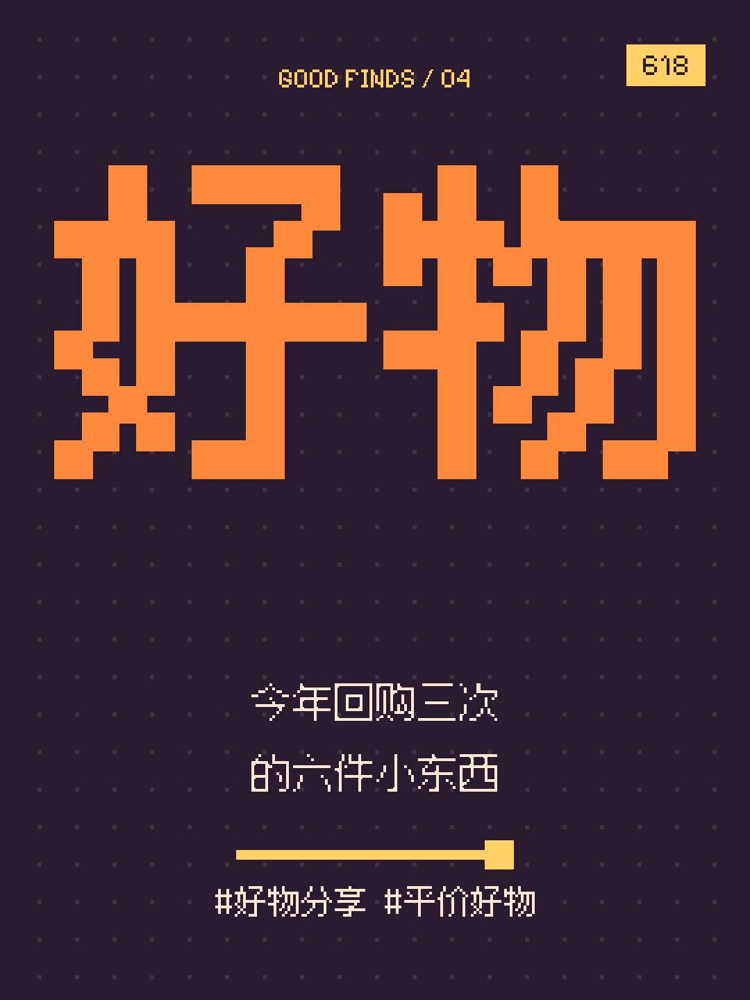

```bash
pixellogo -e "GOOD FINDS / 04" -t 好物 -s 今年回购三次 -s 的六件小东西 -d "#好物分享 #平价好物" \
--badge 618 -m poster -p sunset --bg-pattern dots --shadow-offset 0 -f png \
-o docs/images/gallery/xhs-04-good-finds.png
```

画布 `poster` · 预设 `sunset` · 纹理 `dots` · 分类 好物分享

### 桌面 · 海蓝方格对应桌面改造的整洁感

> Ocean blue grid, echoing a tidy desk setup.

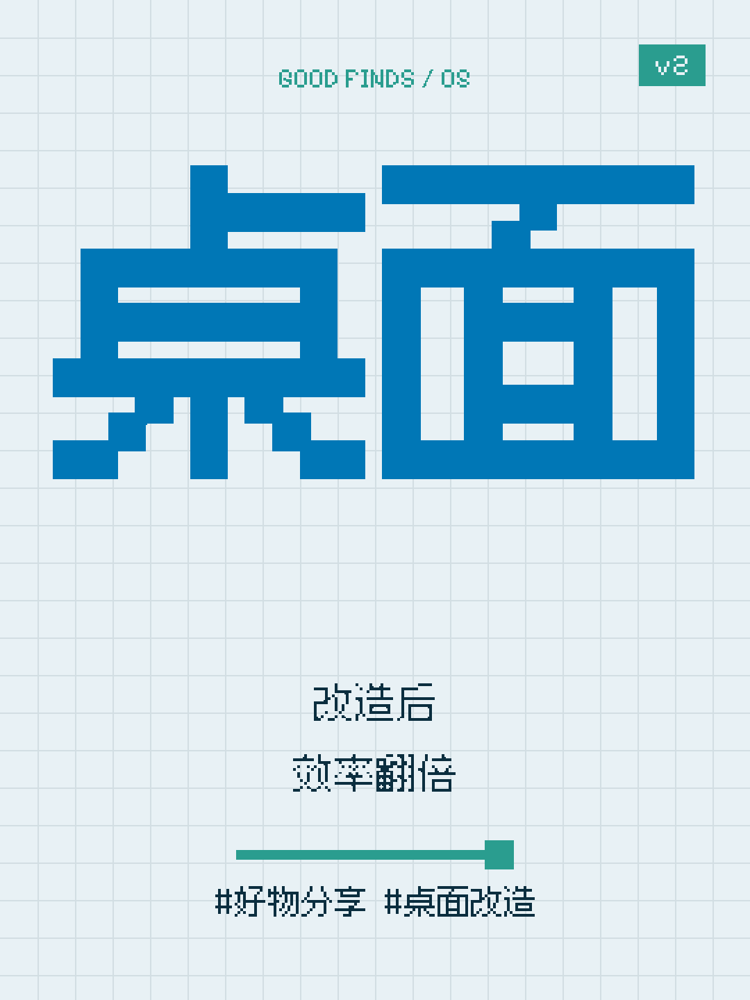

```bash
pixellogo -e "GOOD FINDS / 05" -t 桌面 -s 改造后 -s 效率翻倍 -d "#好物分享 #桌面改造" \
--badge v2 -m poster -p ocean --bg-pattern grid --shadow-offset 0 -f png \
-o docs/images/gallery/xhs-05-desk-setup.png
```

画布 `poster` · 预设 `ocean` · 纹理 `grid` · 分类 好物分享

### 平价 · 在 paper 上压一层暖陶色，避免与米色封面撞色

> Warm terracotta over paper so it does not clash with the beige covers.

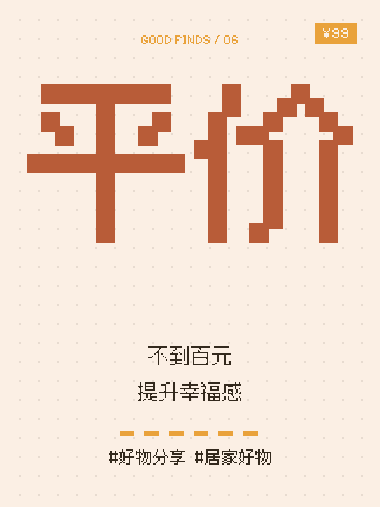

```bash
pixellogo -e "GOOD FINDS / 06" -t 平价 -s 不到百元 -s 提升幸福感 -d "#好物分享 #居家好物" \
--badge "¥99" -m poster -p paper --bg-pattern dots --divider dash --shadow-offset 0 \
--bg "#FBEFE4" --primary "#B85C38" --accent "#E9A23B" -f png \
-o docs/images/gallery/xhs-06-budget-finds.png
```

画布 `poster` · 预设 `paper` + 单色覆盖 · 纹理 `dots` · 分类 好物分享

### 通勤 · 黑白纪实配色，像穿搭号的排版

> Monochrome editorial, the way outfit accounts set type.

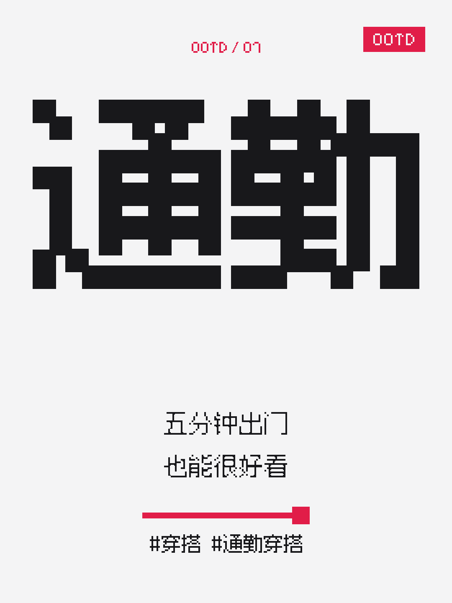

```bash
pixellogo -e "OOTD / 07" -t 通勤 -s 五分钟出门 -s 也能很好看 -d "#穿搭 #通勤穿搭" \
--badge OOTD -m poster -p noir --shadow-offset 0 -f png \
-o docs/images/gallery/xhs-07-commute-ootd.png
```

画布 `poster` · 预设 `noir` · 分类 穿搭

### 秋日 · 森林绿 + 扫描线，做出针织纹理的暗示

> Forest green with scanlines hinting at knitwear.

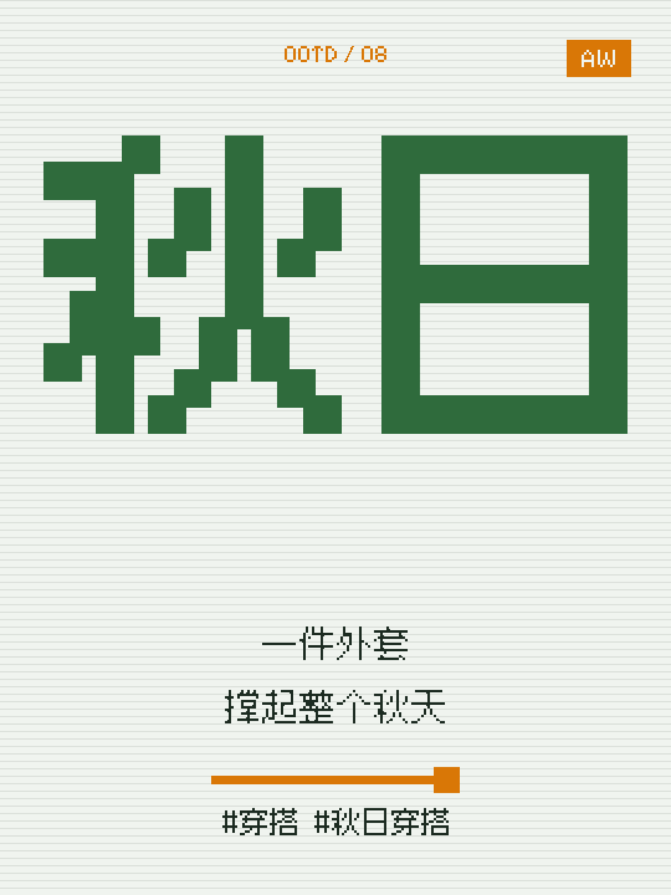

```bash
pixellogo -e "OOTD / 08" -t 秋日 -s 一件外套 -s 撑起整个秋天 -d "#穿搭 #秋日穿搭" \
--badge AW -m poster -p forest --bg-pattern scanlines --shadow-offset 0 -f png \
-o docs/images/gallery/xhs-08-autumn-ootd.png
```

画布 `poster` · 预设 `forest` · 纹理 `scanlines` · 分类 穿搭

### 早饭 · 糖果粉 + 点阵，最“小红书”的一张

> Candy pink and dots: the most Xiaohongshu of the set.

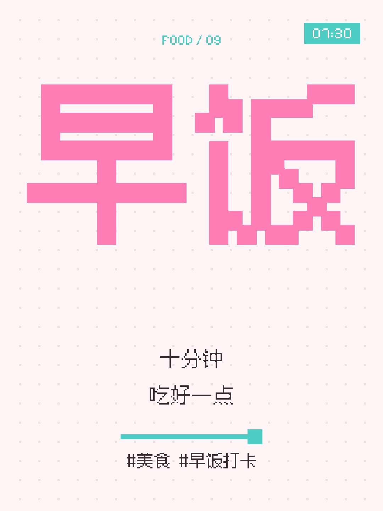

```bash
pixellogo -e "FOOD / 09" -t 早饭 -s 十分钟 -s 吃好一点 -d "#美食 #早饭打卡" \
--badge "07:30" -m poster -p candy --bg-pattern dots --shadow-offset 0 -f png \
-o docs/images/gallery/xhs-09-breakfast.png
```

画布 `poster` · 预设 `candy` · 纹理 `dots` · 分类 美食

### 咖啡 · 纸本方格 + RECIPE 徽标

> Paper grid with a RECIPE badge.

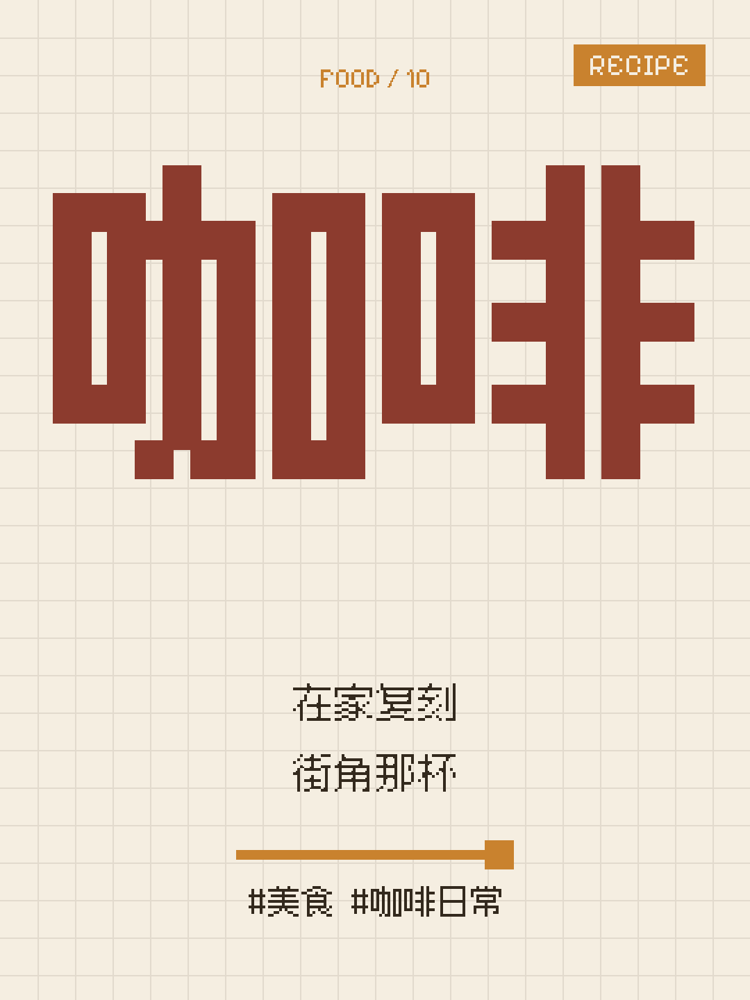

```bash
pixellogo -e "FOOD / 10" -t 咖啡 -s 在家复刻 -s 街角那杯 -d "#美食 #咖啡日常" \
--badge RECIPE -m poster -p paper --bg-pattern grid --shadow-offset 0 -f png \
-o docs/images/gallery/xhs-10-coffee.png
```

画布 `poster` · 预设 `paper` · 纹理 `grid` · 分类 美食

### 出发 · 海蓝扫描线，48 小时倒计时做徽标

> Ocean scanlines, with a 48-hour countdown as the badge.

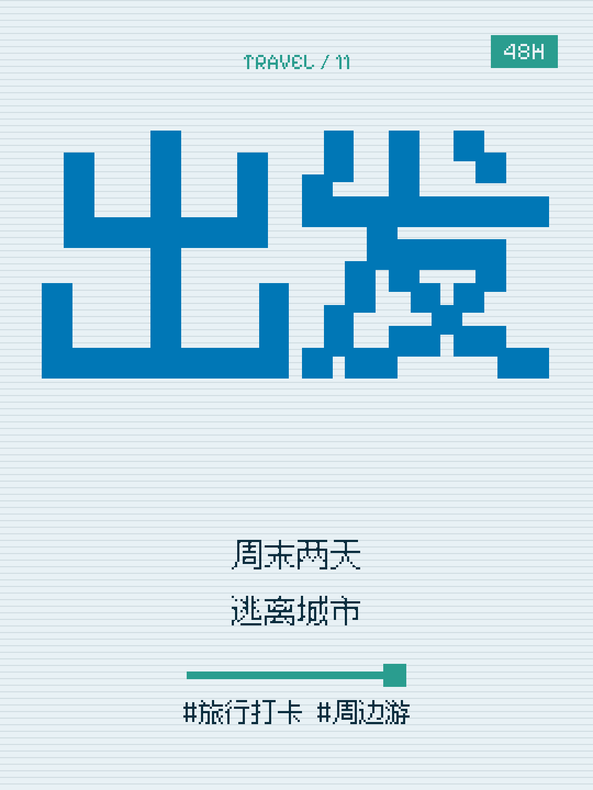

```bash
pixellogo -e "TRAVEL / 11" -t 出发 -s 周末两天 -s 逃离城市 -d "#旅行打卡 #周边游" \
--badge 48H -m poster -p ocean --bg-pattern scanlines --shadow-offset 0 -f png \
-o docs/images/gallery/xhs-11-weekend-trip.png
```

画布 `poster` · 预设 `ocean` · 纹理 `scanlines` · 分类 旅行打卡

### 海边 · 日落配色，18:40 是日落时间

> Sunset palette; 18:40 is the actual sunset time.

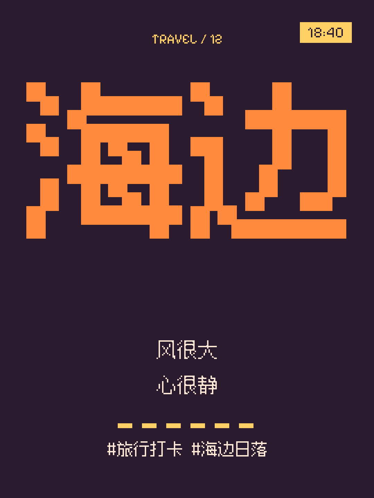

```bash
pixellogo -e "TRAVEL / 12" -t 海边 -s 风很大 -s 心很静 -d "#旅行打卡 #海边日落" \
--badge "18:40" -m poster -p sunset --divider dash --shadow-offset 0 -f png \
-o docs/images/gallery/xhs-12-seaside.png
```

画布 `poster` · 预设 `sunset` · 分类 旅行打卡


## 文字密集型（`poster` / `card` / `slide` / `banner` / `square`）

> Text-heavy

这一组故意把标题、副标题、脚注全部写满，用来验证**折行与自动缩号**在真实文案下的表现：
中文按字断行、拉丁按词断行，超长行会整体缩字号，宁可缩小也不裁切。
六张分别落在五种画布上，可以对照看不同画布的容量差异。

### 快速上手 · 四条命令走完第一次出图

> Four steps from install to your first render.

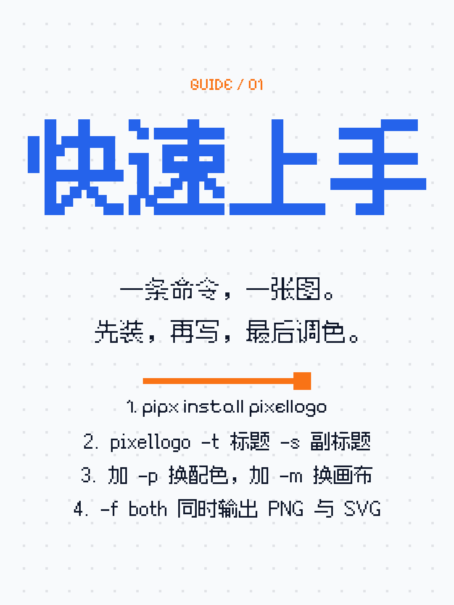

```bash
pixellogo -e "GUIDE / 01" -t 快速上手 -s "一条命令，一张图。" -s "先装，再写，最后调色。" \
-d "1. pipx install pixellogo" -d "2. pixellogo -t 标题 -s 副标题" \
-d "3. 加 -p 换配色，加 -m 换画布" -d "4. -f both 同时输出 PNG 与 SVG" \
-m poster -p minimal --bg-pattern dots --shadow-offset 0 -f png \
-o docs/images/gallery/text-01-quickstart.png
```

画布 `poster` · 预设 `minimal` · 纹理 `dots` · 分类 文字密集

### 能放多少字 · 正文自动折行，字号自动让步

> Body copy wraps, and the font size gives way when it has to.

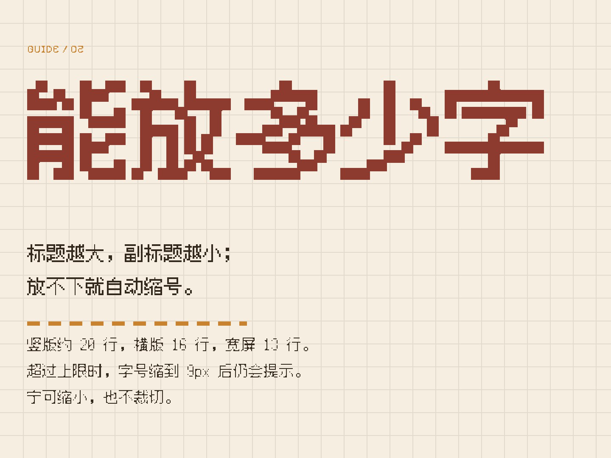

```bash
pixellogo -e "GUIDE / 02" -t 能放多少字 -s "标题越大，副标题越小；" -s "放不下就自动缩号。" \
-d "竖版约 20 行，横版 16 行，宽屏 13 行。" \
-d "超过上限时，字号缩到 9px 后仍会提示。" -d "宁可缩小，也不裁切。" \
-m card -p paper --bg-pattern grid --shadow-offset 0 -f png \
-o docs/images/gallery/text-02-capacity.png
```

画布 `card` · 预设 `paper` · 纹理 `grid` · 分类 文字密集

### 渲染流水线 · 一行写完文字到矩形的全过程

> One line traces text all the way to rectangles.

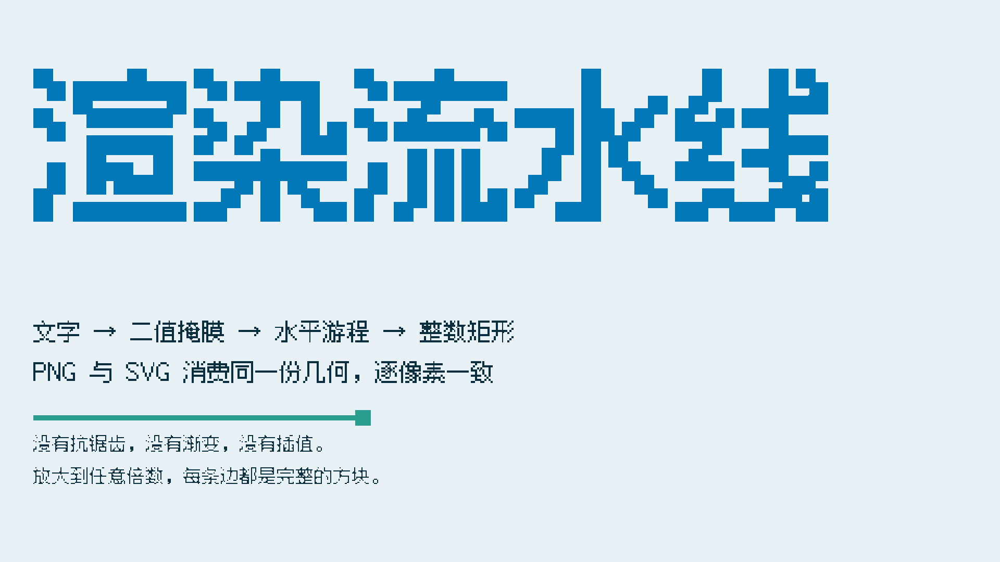

```bash
pixellogo -t 渲染流水线 -s "文字 → 二值掩膜 → 水平游程 → 整数矩形" \
-s "PNG 与 SVG 消费同一份几何，逐像素一致" \
-d "没有抗锯齿，没有渐变，没有插值。" -d "放大到任意倍数，每条边都是完整的方块。" \
-m slide -p ocean --shadow-offset 0 -f png \
-o docs/images/gallery/text-03-pipeline.png
```

画布 `slide` · 预设 `ocean` · 分类 文字密集

### 发布前 · 五行清单占满方图下半部

> A five-item checklist fills the lower half of a square.

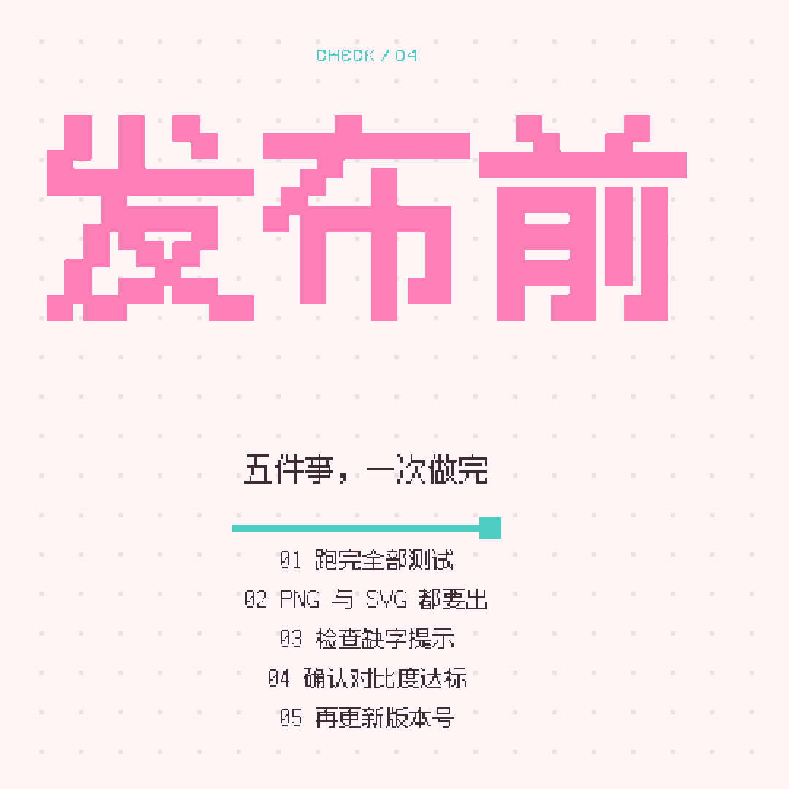

```bash
pixellogo -e "CHECK / 04" -t 发布前 -s "五件事，一次做完" \
-d "01 跑完全部测试" -d "02 PNG 与 SVG 都要出" -d "03 检查缺字提示" \
-d "04 确认对比度达标" -d "05 再更新版本号" \
-m square -p candy --bg-pattern dots --shadow-offset 0 -f png \
-o docs/images/gallery/text-04-checklist.png
```

画布 `square` · 预设 `candy` · 纹理 `dots` · 分类 文字密集

### DENSE · 英文长句在横幅里折成两行

> A long English sentence wraps to two lines inside a 2:1 banner.

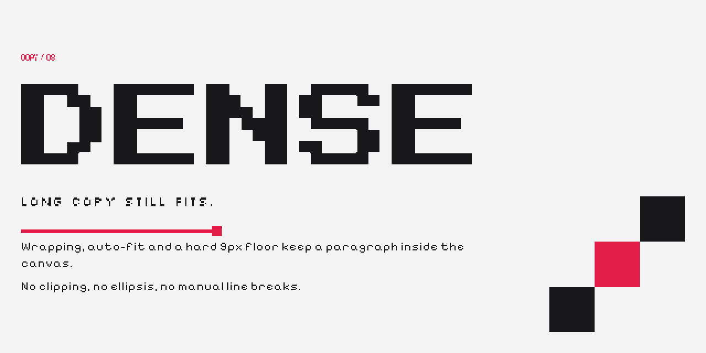

```bash
pixellogo -e "COPY / 05" -t DENSE -s "Long copy still fits." \
-d "Wrapping, auto-fit and a hard 9px floor keep a paragraph inside the canvas." \
-d "No clipping, no ellipsis, no manual line breaks." \
-m banner -p noir --shadow-offset 0 -f png \
-o docs/images/gallery/text-05-english.png
```

画布 `banner` · 预设 `noir` · 分类 文字密集

### 像素字 · 三句副标题加四行脚注

> Three subtitle lines plus four footnotes, still inside the margin.

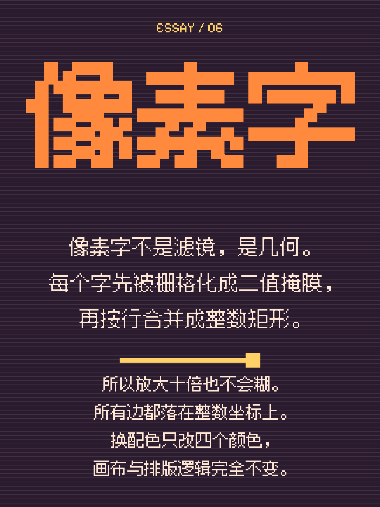

```bash
pixellogo -e "ESSAY / 06" -t 像素字 -s "像素字不是滤镜，是几何。" \
-s "每个字先被栅格化成二值掩膜，" -s "再按行合并成整数矩形。" \
-d "所以放大十倍也不会糊。" -d "所有边都落在整数坐标上。" \
-d "换配色只改四个颜色，" -d "画布与排版逻辑完全不变。" \
-m poster -p sunset --bg-pattern scanlines --shadow-offset 0 -f png \
-o docs/images/gallery/text-06-essay.png
```

画布 `poster` · 预设 `sunset` · 纹理 `scanlines` · 分类 文字密集

## 竖版海报（`poster`，1080×1440 · 3:4）

> Portrait

### PYTHON · 最朴素的竖版封面

> The plainest portrait cover: title, two lines, footnote.

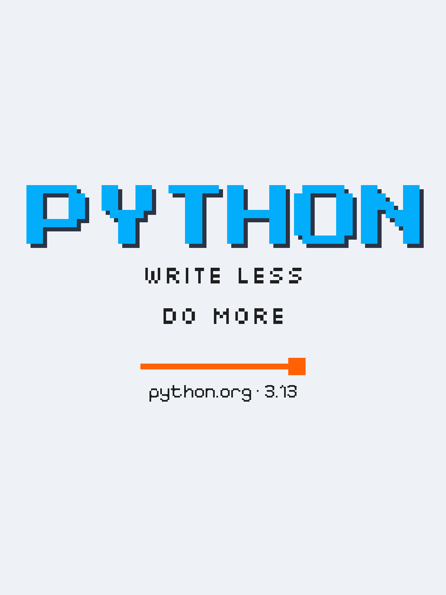

```bash
pixellogo -t PYTHON -s "WRITE LESS" -s "DO MORE" -d "python.org · 3.13" -m poster -p terminal \
-f png -o docs/images/gallery/python.png
```

画布 `poster` · 预设 `terminal` · 副标题 `WRITE LESS / DO MORE`

### KOTLIN · 浅色糖果配亮粉主色

> Light candy ground with a bright pink primary.

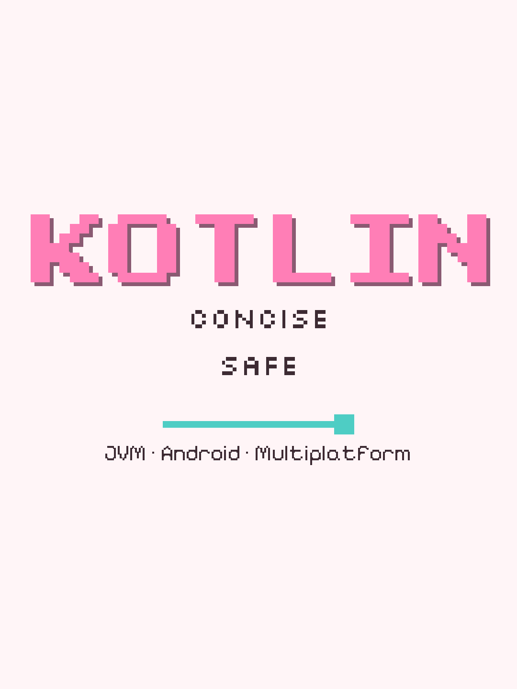

```bash
pixellogo -t KOTLIN -s CONCISE -s SAFE -d "JVM · Android · Multiplatform" -m poster -p candy \
-f png -o docs/images/gallery/kotlin.png
```

画布 `poster` · 预设 `candy` · 副标题 `CONCISE / SAFE`

### DOCKER · 方格纸纹理 + 右上角徽标

> Graph paper texture with a badge in the top corner.

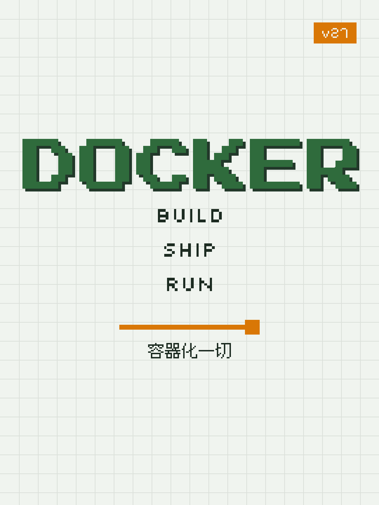

```bash
pixellogo -t DOCKER -s BUILD -s SHIP -s RUN -d 容器化一切 -m poster -p forest --bg-pattern grid \
--badge v27 -f png -o docs/images/gallery/docker.png
```

画布 `poster` · 预设 `forest` · 纹理 `grid` · 副标题 `BUILD / SHIP / RUN`

### GRAPHQL · 加了 eyebrow 小字标签

> Adds a small eyebrow label above the title.

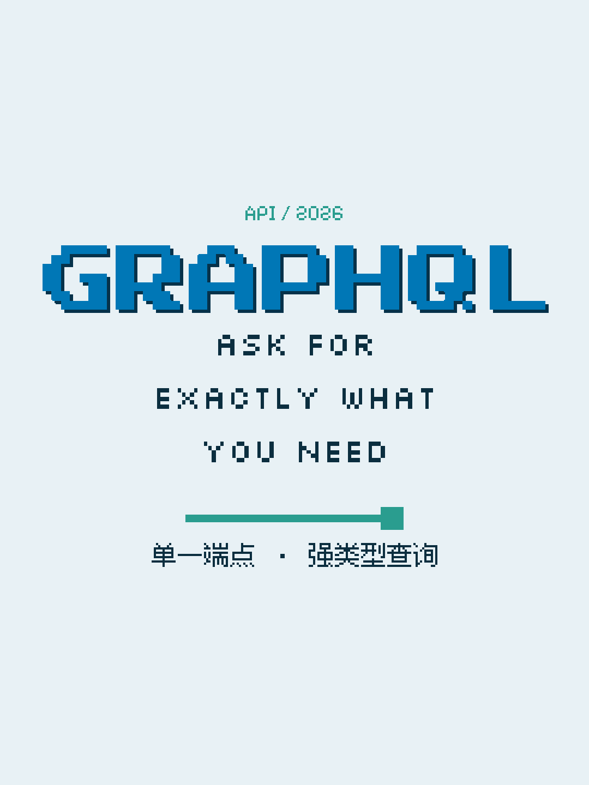

```bash
pixellogo -t GRAPHQL -s "ASK FOR" -s "EXACTLY WHAT" -s "YOU NEED" -d "单一端点 · 强类型查询" -m poster \
-p ocean -e "API / 2026" -f png -o docs/images/gallery/graphql.png
```

画布 `poster` · 预设 `ocean` · 副标题 `ASK FOR / EXACTLY WHAT / YOU NEED`

### ANSIBLE · 黑白底 + 点阵 + 强制大写

> Black on white, dot matrix, forced uppercase.

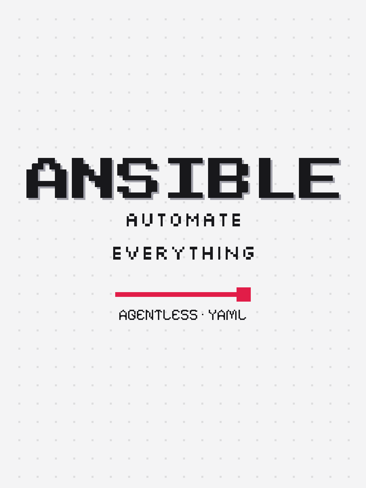

```bash
pixellogo -t ANSIBLE -s AUTOMATE -s EVERYTHING -d "agentless · yaml" -m poster -p noir \
--bg-pattern dots --uppercase -f png -o docs/images/gallery/ansible.png
```

画布 `poster` · 预设 `noir` · 纹理 `dots` · 副标题 `AUTOMATE / EVERYTHING`

### PHP · 投影加粗一档，浮雕感更强

> One step heavier shadow for a relief feel.

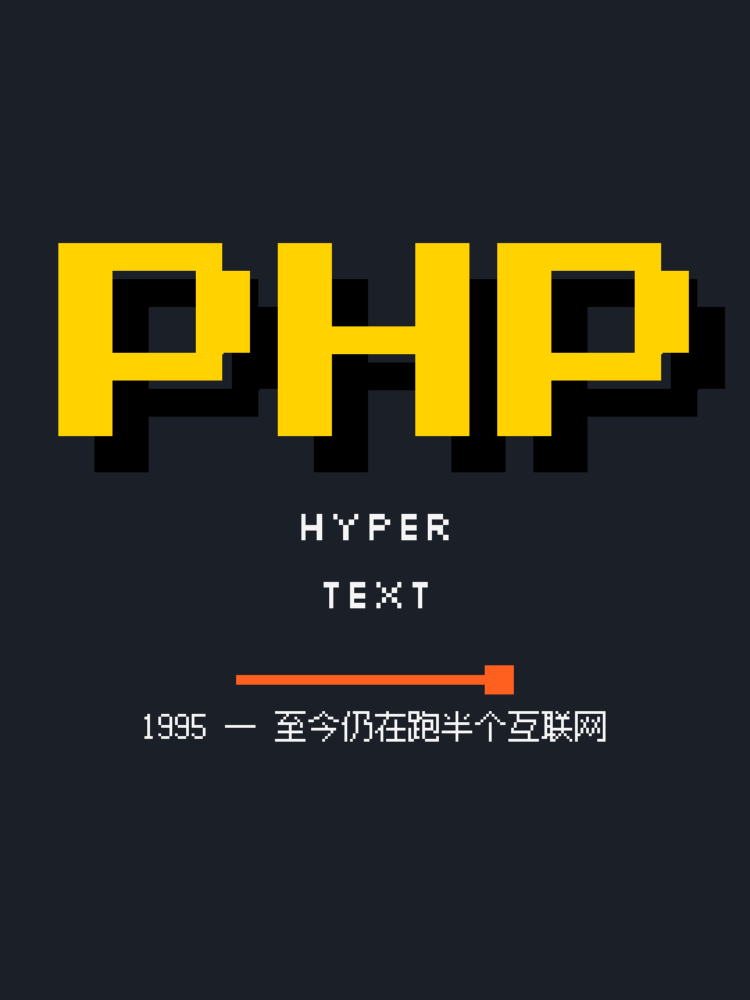

```bash
pixellogo -t PHP -s HYPER -s TEXT -d "1995 — 至今仍在跑半个互联网" -m poster -p arcade --shadow-offset 2 \
-f png -o docs/images/gallery/php.png
```

画布 `poster` · 预设 `arcade` · 副标题 `HYPER / TEXT`

## 横版卡片（`card`，1440×1080 · 4:3）

> Landscape

### RUST · 深色底高对比

> Dark ground, high contrast.

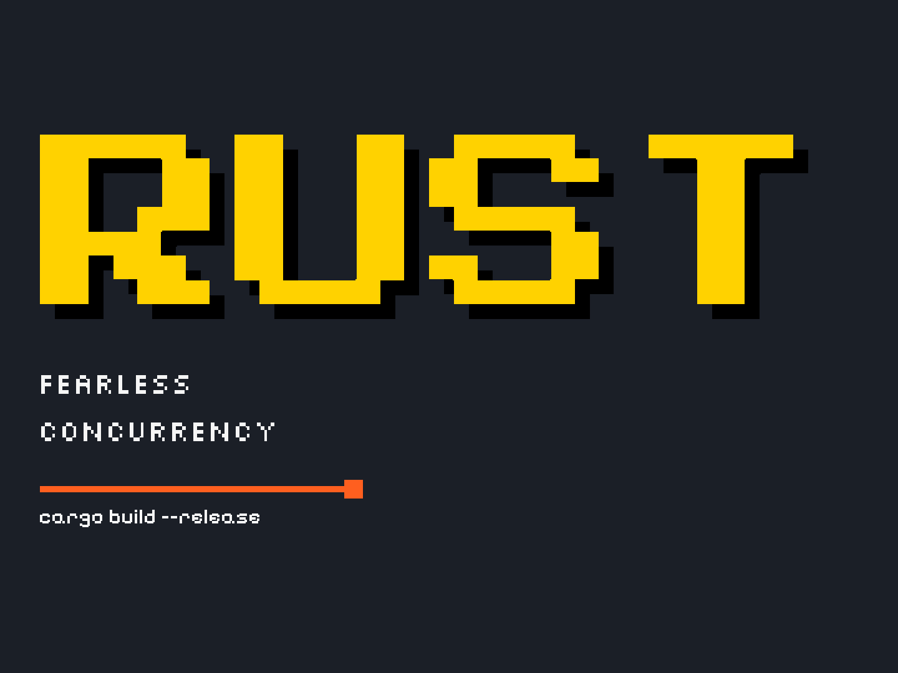

```bash
pixellogo -t RUST -s FEARLESS -s CONCURRENCY -d "cargo build --release" -m card -p arcade -f png \
-o docs/images/gallery/rust.png
```

画布 `card` · 预设 `arcade` · 副标题 `FEARLESS / CONCURRENCY`

### ZIG · 森林绿 + 暖橙强调线

> Forest green with a warm amber rule.

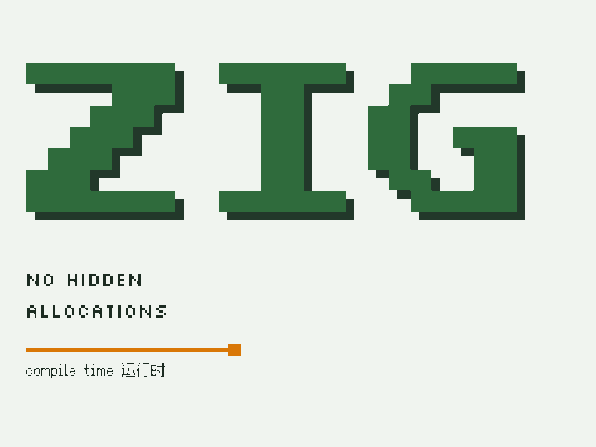

```bash
pixellogo -t ZIG -s "NO HIDDEN" -s ALLOCATIONS -d "compile time 运行时" -m card -p forest -f png \
-o docs/images/gallery/zig.png
```

画布 `card` · 预设 `forest` · 副标题 `NO HIDDEN / ALLOCATIONS`

### ELIXIR · 深海色调

> Deep sea palette.

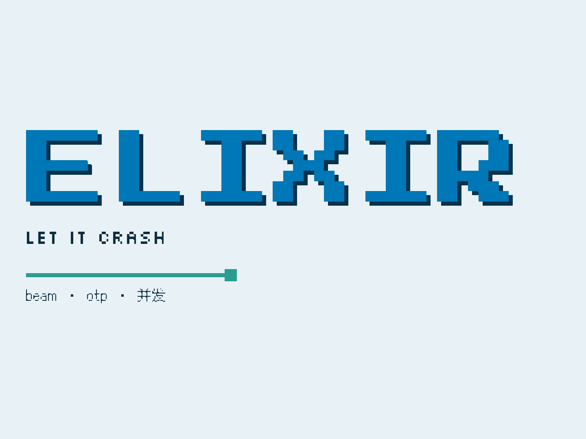

```bash
pixellogo -t ELIXIR -s "LET IT CRASH" -d "beam · otp · 并发" -m card -p ocean -f png \
-o docs/images/gallery/elixir.png
```

画布 `card` · 预设 `ocean` · 副标题 `LET IT CRASH`

### SQL · 极简 + 点阵

> Minimal layout plus dot matrix.

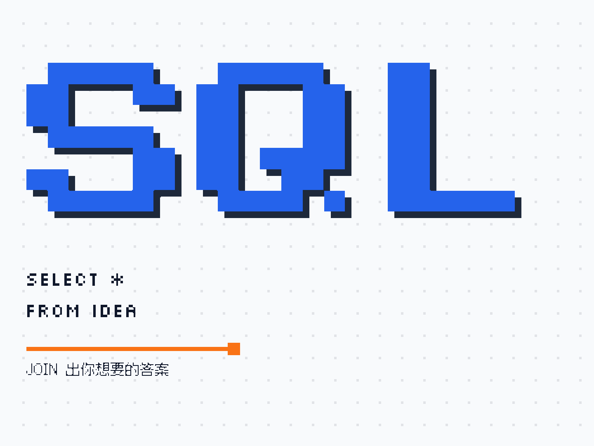

```bash
pixellogo -t SQL -s "SELECT *" -s "FROM IDEA" -d "JOIN 出你想要的答案" -m card -p minimal \
--bg-pattern dots -f png -o docs/images/gallery/sql.png
```

画布 `card` · 预设 `minimal` · 纹理 `dots` · 副标题 `SELECT * / FROM IDEA`

### VIM · 字距收紧

> Tightened letter spacing.

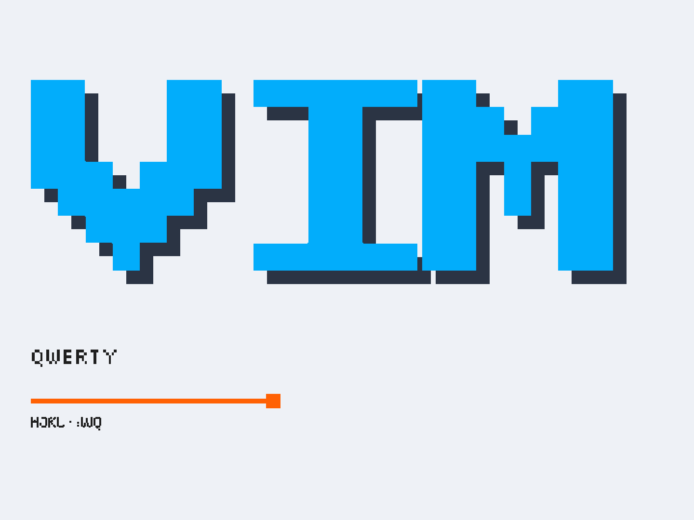

```bash
pixellogo -t VIM -s QWERTY -d "hjkl · :wq" -m card -p terminal --tracking 0.9 --uppercase -f png \
-o docs/images/gallery/vim.png
```

画布 `card` · 预设 `terminal` · 副标题 `QWERTY`

### KUBECTL · 徽标 + 点阵

> Badge plus dot matrix.

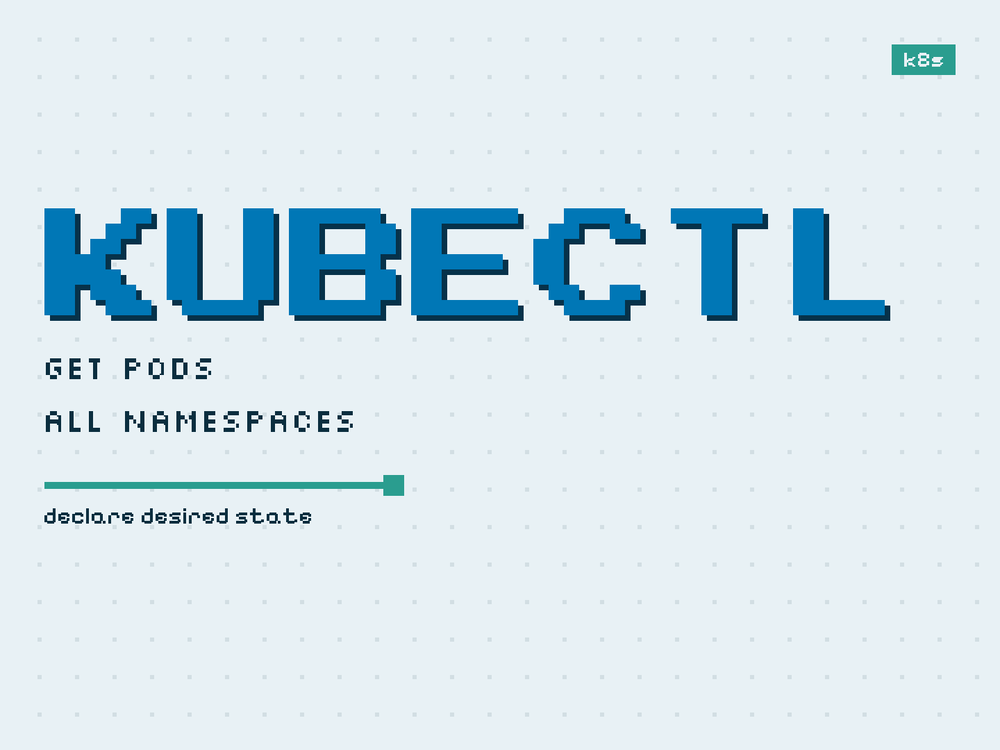

```bash
pixellogo -t KUBECTL -s "GET PODS" -s "ALL NAMESPACES" -d "declare desired state" -m card \
-p ocean --bg-pattern dots --badge k8s -f png -o docs/images/gallery/kubectl.png
```

画布 `card` · 预设 `ocean` · 纹理 `dots` · 副标题 `GET PODS / ALL NAMESPACES`

### KAFKA · 日落配色 + 方格

> Sunset palette on graph paper.

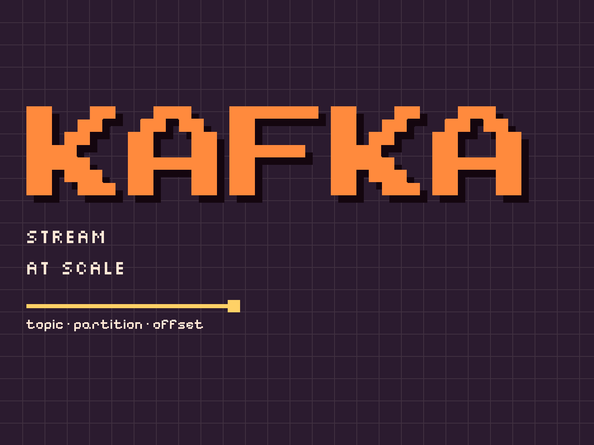

```bash
pixellogo -t KAFKA -s STREAM -s "AT SCALE" -d "topic · partition · offset" -m card -p sunset \
--bg-pattern grid -f png -o docs/images/gallery/kafka.png
```

画布 `card` · 预设 `sunset` · 纹理 `grid` · 副标题 `STREAM / AT SCALE`

### NIX · 纸本 + 虚线分隔

> Paper ground with a dashed divider.

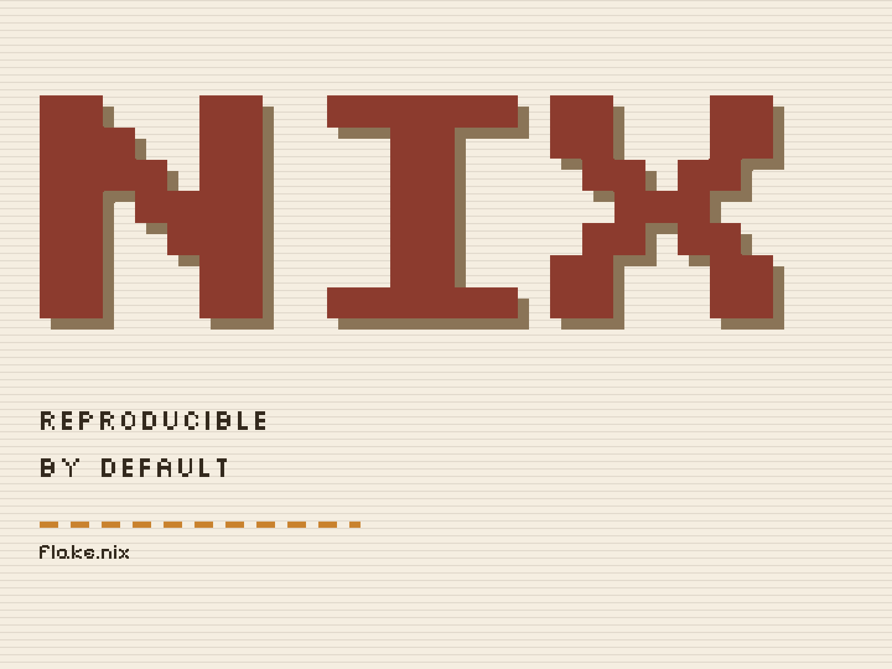

```bash
pixellogo -t NIX -s REPRODUCIBLE -s "BY DEFAULT" -d flake.nix -m card -p paper \
--bg-pattern scanlines --divider dash -f png -o docs/images/gallery/nix.png
```

画布 `card` · 预设 `paper` · 纹理 `scanlines` · 副标题 `REPRODUCIBLE / BY DEFAULT`

### WASM · 赛博绿 + 右侧阶梯装饰

> Cyber green with the stair motif on the right.

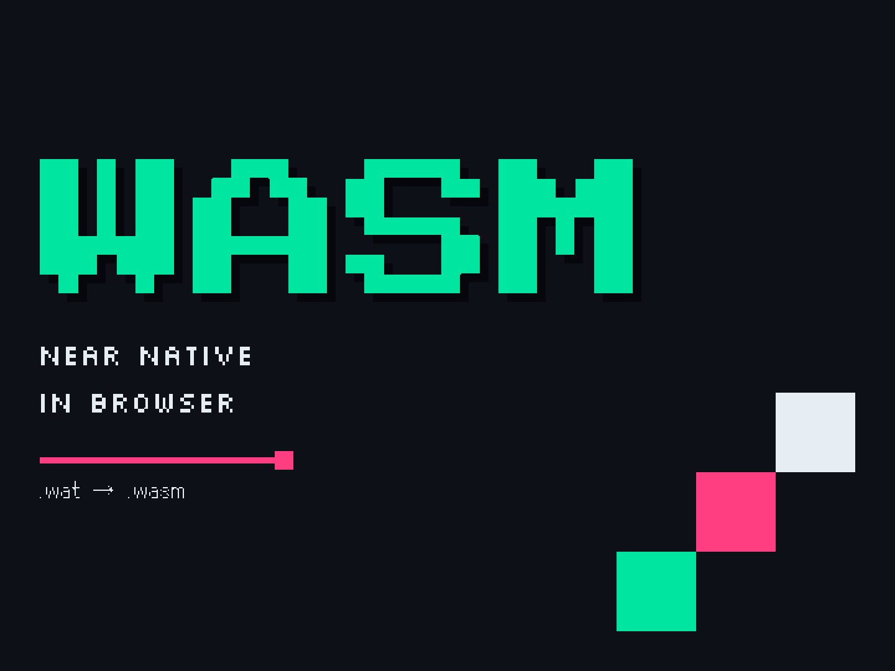

```bash
pixellogo -t WASM -s "NEAR NATIVE" -s "IN BROWSER" -d ".wat → .wasm" -m card -p cyber \
--motif blocks -f png -o docs/images/gallery/wasm.png
```

画布 `card` · 预设 `cyber` · 副标题 `NEAR NATIVE / IN BROWSER`

### COBOL · 居中对齐 + 固定字号

> Centered, with a fixed title size.

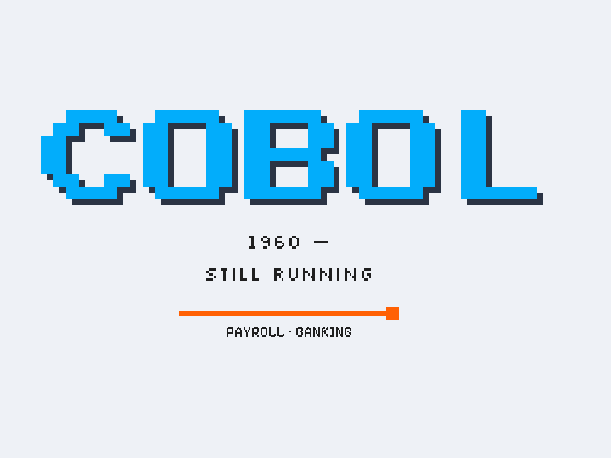

```bash
pixellogo -t COBOL -s "1960 —" -s "STILL RUNNING" -d "PAYROLL · BANKING" -m card -p terminal \
--align center --title-size 120 -f png -o docs/images/gallery/cobol.png
```

画布 `card` · 预设 `terminal` · 副标题 `1960 — / STILL RUNNING`

## 仓库横幅（`banner`，1280×640 · 2:1）

> Banners

### GO · 默认带右下阶梯

> Ships with the stair motif bottom-right.

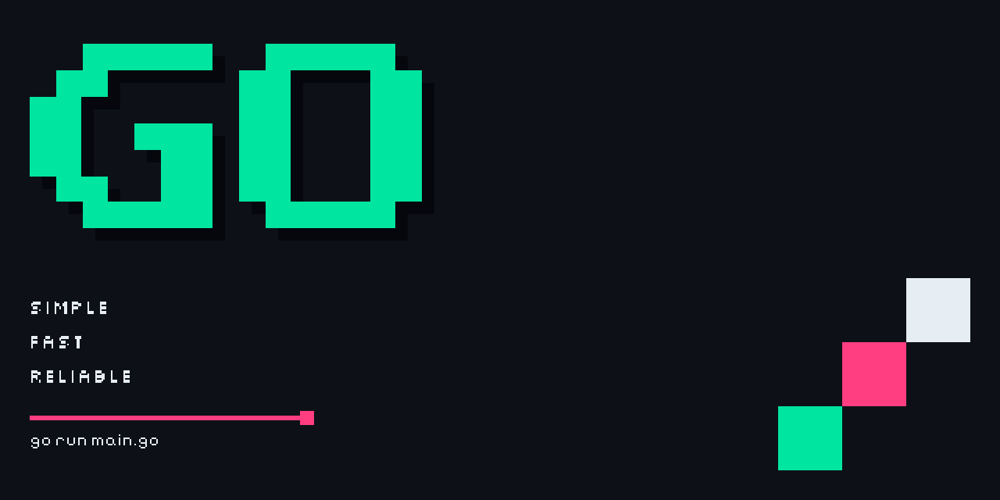

```bash
pixellogo -t GO -s SIMPLE -s FAST -s RELIABLE -d "go run main.go" -m banner -p cyber -f png \
-o docs/images/gallery/go.png
```

画布 `banner` · 预设 `cyber` · 副标题 `SIMPLE / FAST / RELIABLE`

### SWIFT · 日落橙标题

> Sunset orange title.

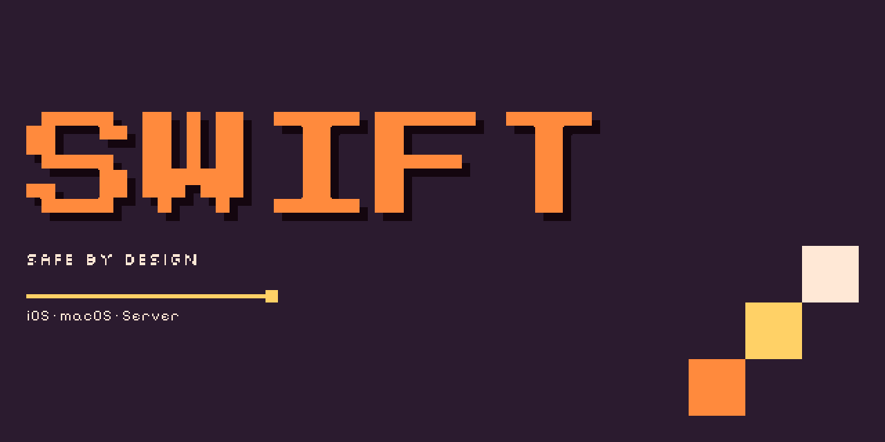

```bash
pixellogo -t SWIFT -s "SAFE BY DESIGN" -d "iOS · macOS · Server" -m banner -p sunset -f png \
-o docs/images/gallery/swift.png
```

画布 `banner` · 预设 `sunset` · 副标题 `SAFE BY DESIGN`

### BASH · 扫描线 + 赛博

> Scanlines over the cyber palette.

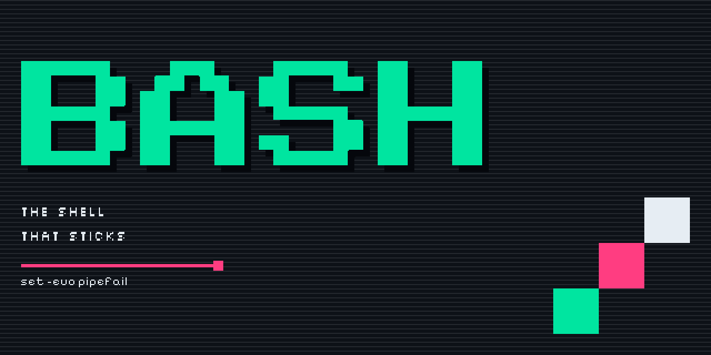

```bash
pixellogo -t BASH -s "THE SHELL" -s "THAT STICKS" -d "set -euo pipefail" -m banner -p cyber \
--bg-pattern scanlines -f png -o docs/images/gallery/bash.png
```

画布 `banner` · 预设 `cyber` · 纹理 `scanlines` · 副标题 `THE SHELL / THAT STICKS`

### NGINX · 单色覆盖：把强调线改成蓝

> Single-colour override: the accent rule turns blue.

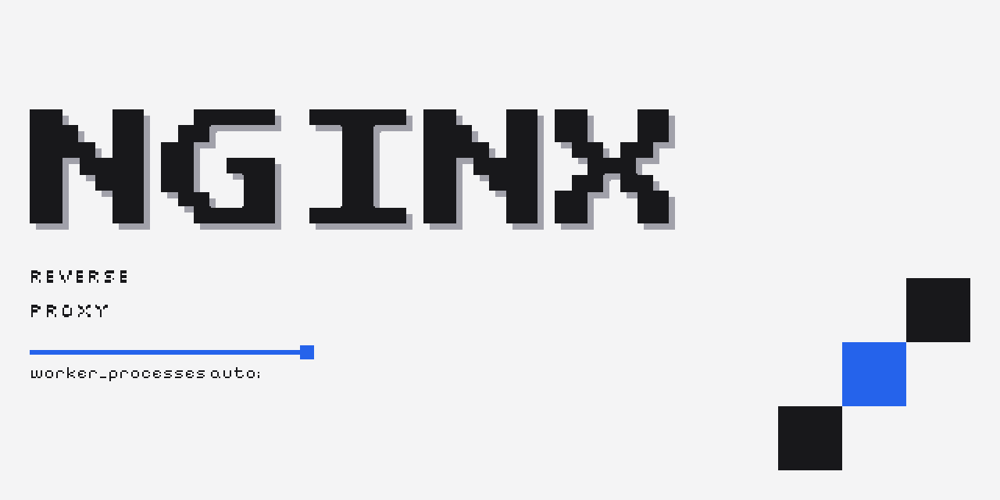

```bash
pixellogo -t NGINX -s REVERSE -s PROXY -d "worker_processes auto;" -m banner -p noir \
--accent "#2563EB" -f png -o docs/images/gallery/nginx.png
```

画布 `banner` · 预设 `noir` · 副标题 `REVERSE / PROXY`

### LINUX · 关掉右下装饰

> Motif switched off.

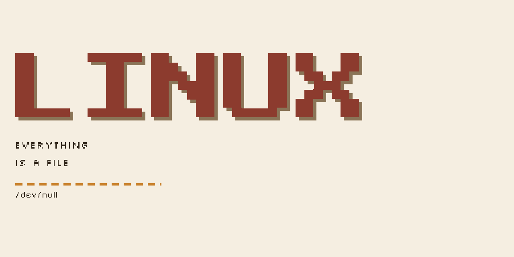

```bash
pixellogo -t LINUX -s EVERYTHING -s "IS A FILE" -d /dev/null -m banner -p paper --motif none \
-f png -o docs/images/gallery/linux.png
```

画布 `banner` · 预设 `paper` · 副标题 `EVERYTHING / IS A FILE`

### TERRAFORM · 方格 + 大写

> Graph paper, forced uppercase.

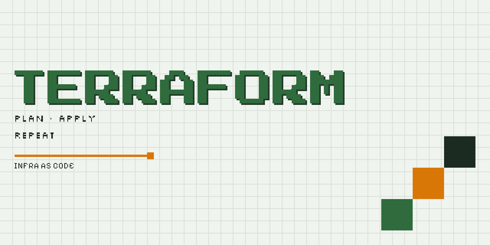

```bash
pixellogo -t TERRAFORM -s "PLAN · APPLY" -s REPEAT -d "infra as code" -m banner -p forest \
--bg-pattern grid --uppercase -f png -o docs/images/gallery/terraform.png
```

画布 `banner` · 预设 `forest` · 纹理 `grid` · 副标题 `PLAN · APPLY / REPEAT`

## 宽屏幻灯片（`slide`，1920×1080 · 16:9）

> Widescreen

### TYPESCRIPT · 宽幅左对齐

> Wide canvas, left-aligned.

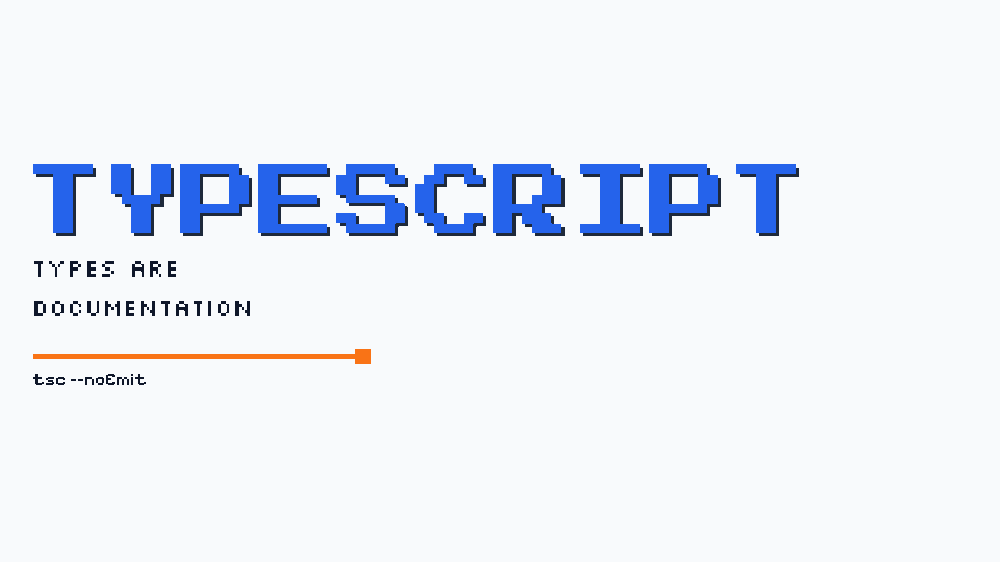

```bash
pixellogo -t TYPESCRIPT -s "TYPES ARE" -s DOCUMENTATION -d "tsc --noEmit" -m slide -p minimal \
-f png -o docs/images/gallery/typescript.png
```

画布 `slide` · 预设 `minimal` · 副标题 `TYPES ARE / DOCUMENTATION`

### HASKELL · 块状分隔线

> Block divider between subtitle and footnote.

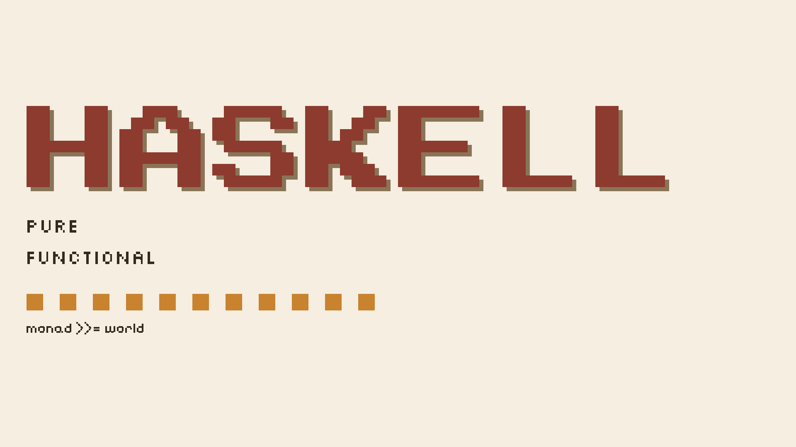

```bash
pixellogo -t HASKELL -s PURE -s FUNCTIONAL -d "monad >>= world" -m slide -p paper \
--divider block -f png -o docs/images/gallery/haskell.png
```

画布 `slide` · 预设 `paper` · 副标题 `PURE / FUNCTIONAL`

### POSTGRESQL · 方格 + 徽标

> Graph paper plus a badge.

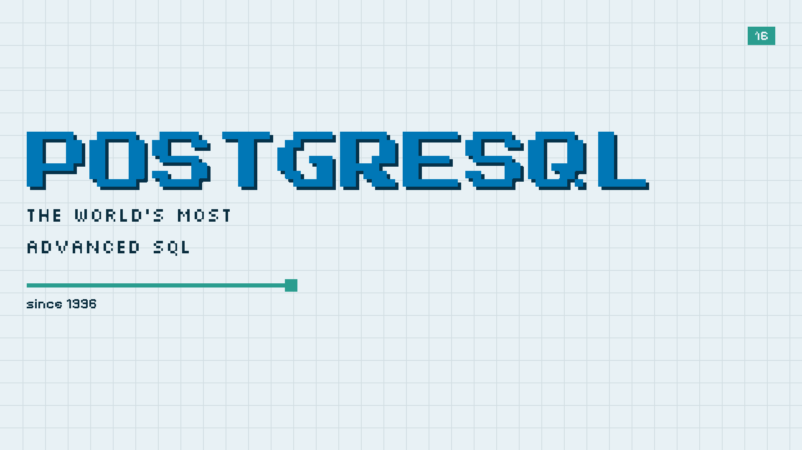

```bash
pixellogo -t POSTGRESQL -s "THE WORLD'S MOST" -s "ADVANCED SQL" -d "since 1996" -m slide \
-p ocean --bg-pattern grid --badge 16 -f png -o docs/images/gallery/postgresql.png
```

画布 `slide` · 预设 `ocean` · 纹理 `grid` · 副标题 `THE WORLD'S MOST / ADVANCED SQL`

### GRPC · 森林绿宽屏

> Forest green on a wide canvas.

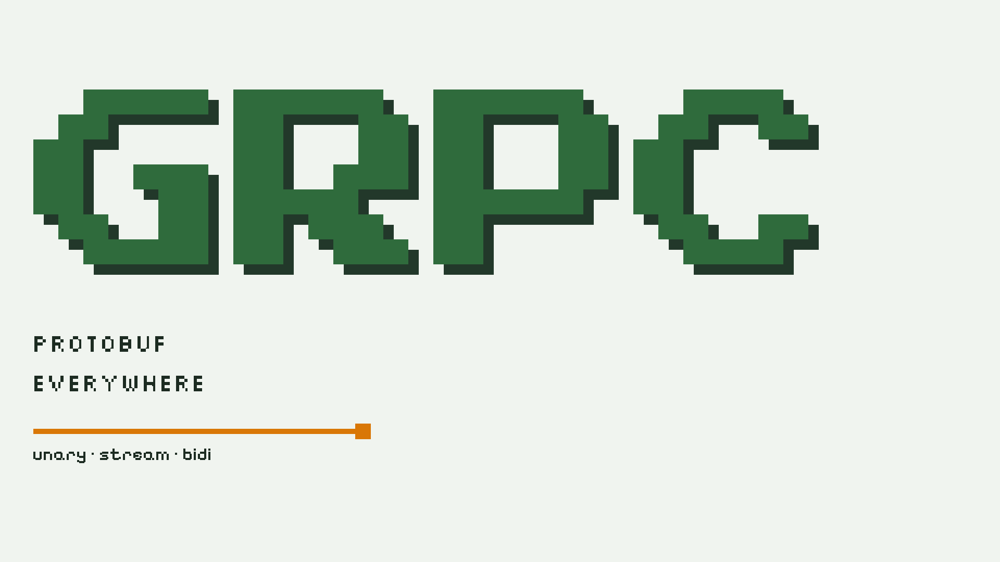

```bash
pixellogo -t GRPC -s PROTOBUF -s EVERYWHERE -d "unary · stream · bidi" -m slide -p forest -f png \
-o docs/images/gallery/grpc.png
```

画布 `slide` · 预设 `forest` · 副标题 `PROTOBUF / EVERYWHERE`

## 方形图片（`square`，1080×1080 · 1:1）

> Square

### C++ · 方图，黑底白字

> Square, white on black.

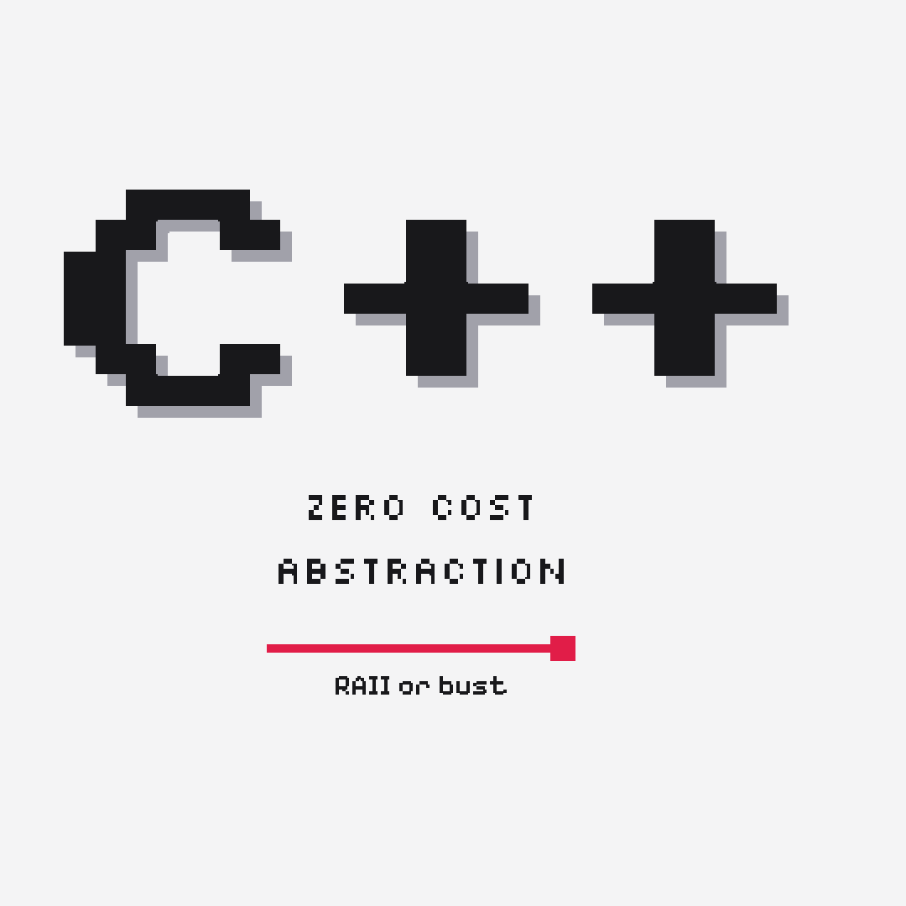

```bash
pixellogo -t C++ -s "ZERO COST" -s ABSTRACTION -d "RAII or bust" -m square -p noir -f png \
-o docs/images/gallery/cpp.png
```

画布 `square` · 预设 `noir` · 副标题 `ZERO COST / ABSTRACTION`

### LUA · 方图 + 方格

> Square with graph paper.

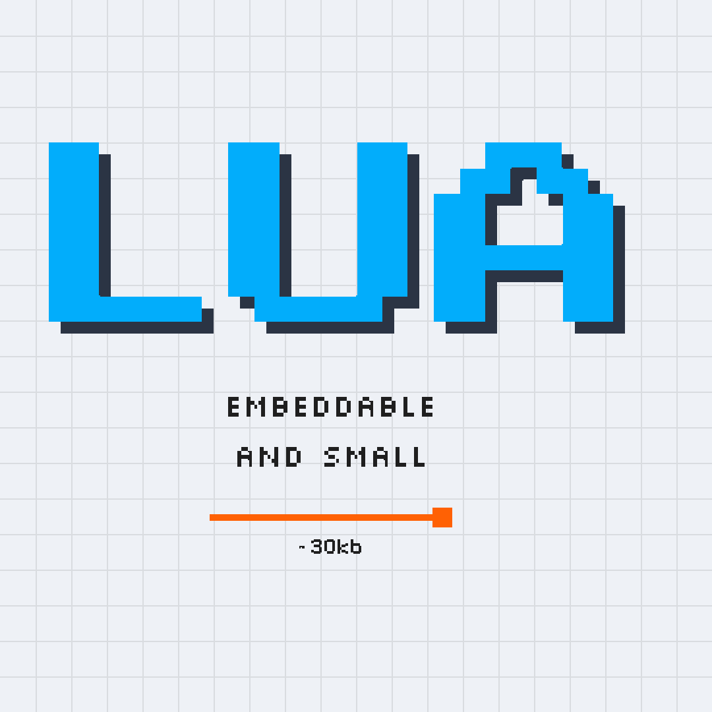

```bash
pixellogo -t LUA -s EMBEDDABLE -s "AND SMALL" -d "~30kb" -m square -p terminal --bg-pattern grid \
-f png -o docs/images/gallery/lua.png
```

画布 `square` · 预设 `terminal` · 纹理 `grid` · 副标题 `EMBEDDABLE / AND SMALL`

### REDIS · 扫描线 + 街机配色

> Scanlines and arcade colour.

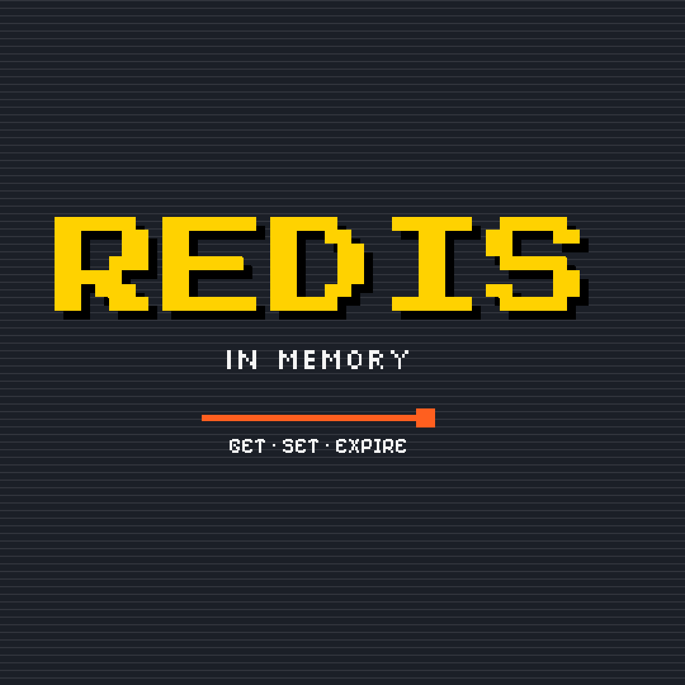

```bash
pixellogo -t REDIS -s "IN MEMORY" -d "GET · SET · EXPIRE" -m square -p arcade \
--bg-pattern scanlines -f png -o docs/images/gallery/redis.png
```

画布 `square` · 预设 `arcade` · 纹理 `scanlines` · 副标题 `IN MEMORY`

### GIT · 方图极简

> Minimal square.


```bash
pixellogo -t GIT -s COMMIT -s EARLY -s "COMMIT OFTEN" -d "git rebase -i" -m square -p minimal \
-f png -o docs/images/gallery/git.png
```

画布 `square` · 预设 `minimal` · 副标题 `COMMIT / EARLY / COMMIT OFTEN`

### RUBY · 行高放宽

> Loosened line height.

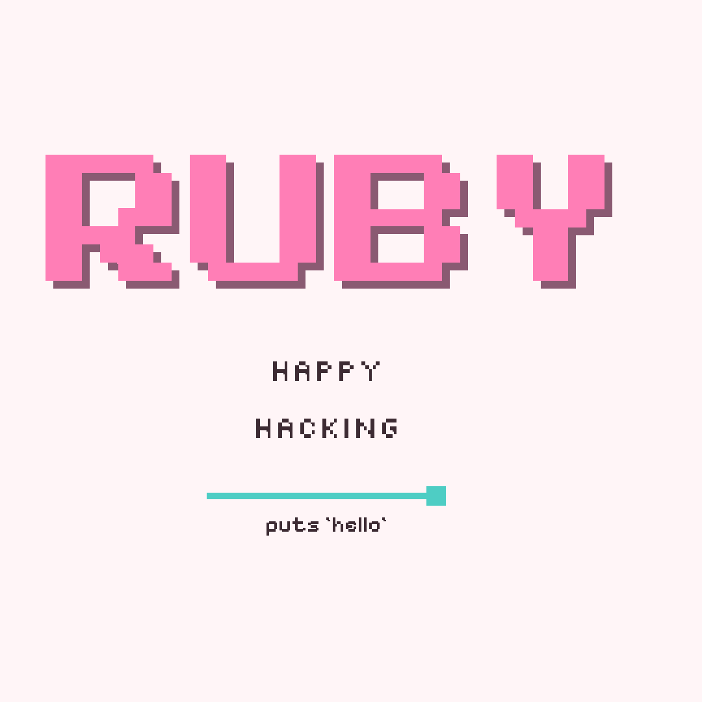

```bash
pixellogo -t RUBY -s HAPPY -s HACKING -d "puts 'hello'" -m square -p candy --leading 1.2 -f png \
-o docs/images/gallery/ruby.png
```

画布 `square` · 预设 `candy` · 副标题 `HAPPY / HACKING`

### ELISP · 日落 + 点阵

> Sunset with a dot matrix.

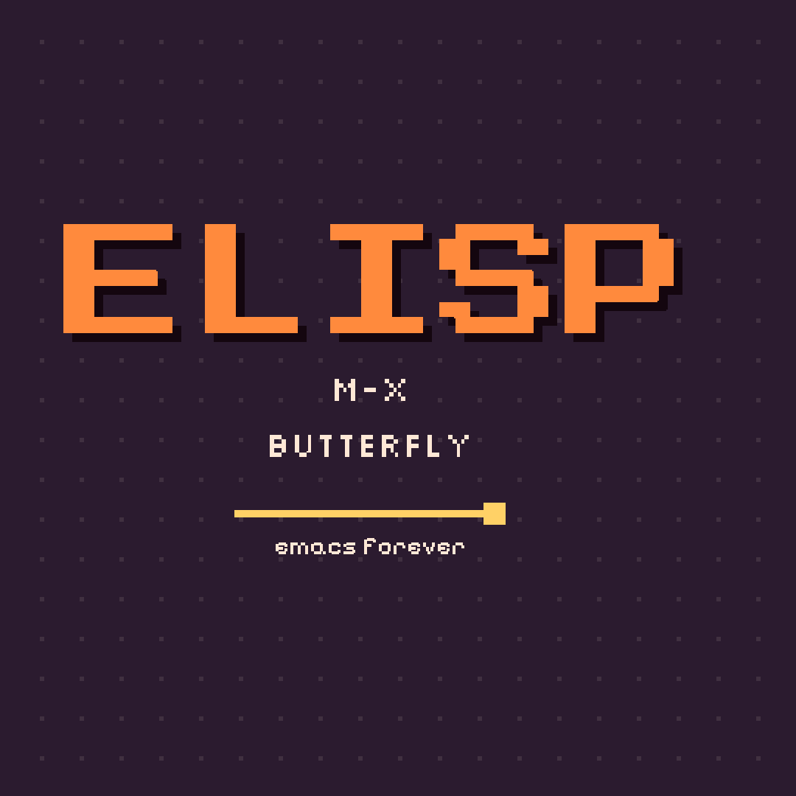

```bash
pixellogo -t ELISP -s M-x -s BUTTERFLY -d "emacs forever" -m square -p sunset --bg-pattern dots \
-f png -o docs/images/gallery/elisp.png
```

画布 `square` · 预设 `sunset` · 纹理 `dots` · 副标题 `M-x / BUTTERFLY`

## 多语言与在地文化

> Multilingual

同一套渲染管线，换掉字形变体就能贴合当地的正字法：日文用日标字形、韩文用谚文、繁体用台标 / 港标字形。中英混排会自动切回中文像素字体，不会出现豆腐块。

### 日语（`--lang ja`）

> 需要先执行 `pixellogo fonts install ja`；缺字体时命令会直接提示安装。

### 人間失格 · 太宰治《人间失格》，四个字刚好撑满竖版

> Dazai's No Longer Human; four characters fill the portrait.

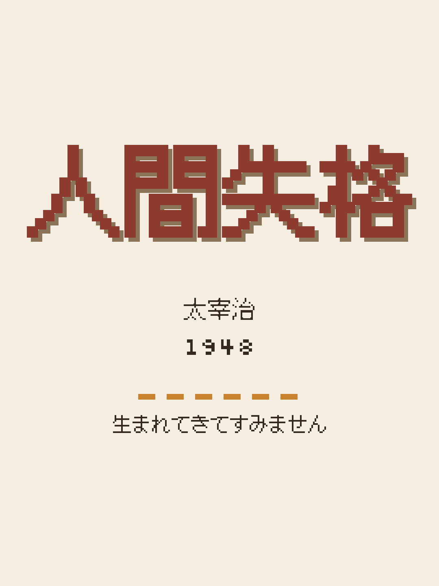

```bash
pixellogo -t 人間失格 -s 太宰治 -s 1948 -d 生まれてきてすみません -m poster -p paper --lang ja -f png \
-o docs/images/gallery/ja-ningen-shikkaku.png
```

画布 `poster` · 预设 `paper` · 语言 `ja` · 副标题 `太宰治 / 1948`

### 坂本龍馬 · 坂本龙马致姊信名句：把日本重新洗一遍

> Ryouma's letter to his sister: wash Japan once more.


```bash
pixellogo -t 坂本龍馬 -s "1836 — 1867" -s "土佐 · 幕末" -d 日本を今一度せんたくいたし候 -m banner -p terminal \
--lang ja -f png -o docs/images/gallery/ja-sakamoto-ryoma.png
```

画布 `banner` · 预设 `terminal` · 语言 `ja` · 副标题 `1836 — 1867 / 土佐 · 幕末`

### 東京 · 东京都：方图 + 点阵，像城市规划图

> Tokyo as a square with dots, like a city plan.


```bash
pixellogo -t 東京 -s TOKYO -d "人口約1400万 · 47都道府県の中心" -m square -p ocean --bg-pattern dots \
--lang ja -f png -o docs/images/gallery/ja-tokyo.png
```

画布 `square` · 预设 `ocean` · 纹理 `dots` · 语言 `ja` · 副标题 `TOKYO`

### 韩语（`--lang ko`）

> 需要先执行 `pixellogo fonts install ko`；缺字体时命令会直接提示安装。

### 안중근 · 安重根义士：黑白纪实配色，适合纪念性画面

> Ahn Jung-geun: monochrome documentary palette.


```bash
pixellogo -t 안중근 -s "安重根 義士" -s "1879 — 1910" -d "동양평화론 · 하얼빈 의거" -m poster -p noir --lang ko \
-f png -o docs/images/gallery/ko-ahn-jung-geun.png
```

画布 `poster` · 预设 `noir` · 语言 `ko` · 副标题 `安重根 義士 / 1879 — 1910`

### 한글 · 训民正音：谚文与它的原始字数

> Hangul and its original 28 letters.


```bash
pixellogo -t 한글 -s 세종대왕 -s 1443 -d "훈민정음 · 28字" -m card -p paper --lang ko -f png \
-o docs/images/gallery/ko-hangul.png
```

画布 `card` · 预设 `paper` · 语言 `ko` · 副标题 `세종대왕 / 1443`

### 서울 · 首尔：汉江与六百年都城

> Seoul: the Han River and six centuries of capital.


```bash
pixellogo -t 서울 -s SEOUL -d "한강 · 600년 수도" -m square -p sunset --bg-pattern grid --lang ko \
-f png -o docs/images/gallery/ko-seoul.png
```

画布 `square` · 预设 `sunset` · 纹理 `grid` · 语言 `ko` · 副标题 `SEOUL`

### 繁体中文（`--lang zh-hant`）

> 需要先执行 `pixellogo fonts install zh-hant`；缺字体时命令会直接提示安装。

### 蘭亭 · 《兰亭集序》开篇句，繁体字形

> The opening of the Lantingji Xu, in traditional glyphs.


```bash
pixellogo -t 蘭亭 -s 王羲之 -s 永和九年 -d 仰觀宇宙之大 -m poster -p paper --lang zh-hant -f png \
-o docs/images/gallery/hant-lanting.png
```

画布 `poster` · 预设 `paper` · 语言 `zh-hant` · 副标题 `王羲之 / 永和九年`

### 香港 · 香港：维港与天星小轮，扫描线像海面反光

> Hong Kong: Victoria Harbour and the Star Ferry.


```bash
pixellogo -t 香港 -s "HONG KONG" -d "維多利亞港 · 天星小輪" -m banner -p ocean --bg-pattern scanlines \
--lang zh-hant -f png -o docs/images/gallery/hant-hongkong.png
```

画布 `banner` · 预设 `ocean` · 纹理 `scanlines` · 语言 `zh-hant` · 副标题 `HONG KONG`

---

## 再往下可以怎么改

- 换输出格式：把 `-f png` 改成 `-f svg`（纯矢量）或 `-f both`。
- 换尺寸：把 `-m card` 换成其他模式，或用 `--size 1200x900` 自定义。
- 改配色：加 `--accent "#FF3D81"` 之类的单色覆盖，或在预设基础上用 `--bg` / `--primary`。
- 换字形变体：`--lang ja` / `ko` / `zh-hant`，缺字体时先 `pixellogo fonts install <lang>`。
- 批量出图：把多条配置写进一个 JSONC 数组，用 `pixellogo -c batch.jsonc -o out/` 一次跑完，详见 [README 的配置文件一节](../README.md#配置文件jsonc)。

## 更新记录

> Changelog

- 2026-11-05 | 画廊改为 GitHub Pages 首页，支持中英双语与深浅色切换，每张卡片可复制命令；新增 6 张文字密集型示例；修复方块分隔线压字 | Gallery becomes the Pages homepage with EN/ZH and light/dark switching plus copyable commands; six text-heavy samples added; the block divider no longer overlaps body text
- 2026-11-04 | 新增 12 张小红书风格封面与可浏览画廊页面 | Twelve Xiaohongshu-style covers and a browsable gallery page
- 2026-11-03 | 初版：40 张命令示例，覆盖 5 种画布、10 套预设、4 种纹理 | First release: 40 command samples across 5 canvases, 10 presets and 4 textures

返回 [README](../README.md)。
